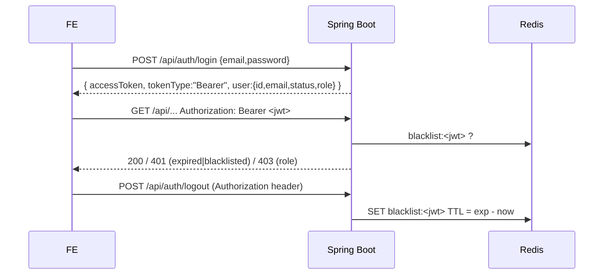
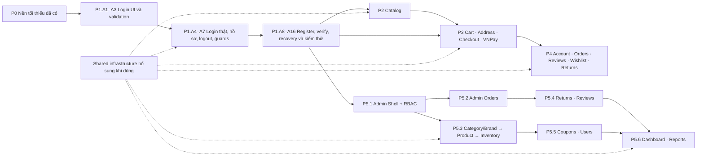

# Frontend Master Implementation Plan — Electronics E-commerce

> Nguồn: khảo sát toàn bộ `ecommerce-backend` (Spring Boot **4.1.1**, Java 21, Jackson 3, OAuth2 Resource Server JWT, Redis, MySQL, VNPay, springdoc-openapi).
> Đối chiếu source backend ngày 2026-10-17: 16 module nghiệp vụ · 24 controller · 85 handler mapping (86 cặp HTTP method + URL vì hủy đơn hỗ trợ cả PUT và POST).

> **Cách triển khai hiện tại — cập nhật 2026-10-17:** học React bằng giao diện và luồng Auth chạy với backend thật. Đọc [Mục 3](#3-lộ-trình-triển-khai-roadmap--dependency-rationale), sau đó làm từng mốc A1 → A16 trong Phase 1. Phần nền tảng đã có được giữ lại; hạ tầng còn thiếu được bổ sung ngay khi màn hình cần đến. Không cần hoàn thành toàn bộ shared infrastructure trước khi làm `/login`.

> **Tiến độ cập nhật 2026-10-25:** **Auth đã chốt trong phạm vi người dùng lựa chọn.** Phase 2 đã có commit B1–B10, gần nhất là B10 `2fee741`. Người dùng quyết định làm B11 (policy) sau các phase chính. B12 chưa hoàn tất: còn metadata và chưa có biên bản kiểm tra responsive, accessibility, toàn luồng với backend/trình duyệt. **Điểm tiếp tục: Phase 3 C1 — giỏ hàng guest và thêm vào giỏ từ chi tiết sản phẩm.** Đây là chuyển giai đoạn theo phạm vi đã chọn, không phải xác nhận toàn bộ tiêu chí Phase 2 đã đạt. A13 bỏ theo yêu cầu; A15 (kiểm thử tự động), A16 (CI) để sau. Không dùng OpenAPI generation.

> **Cách phối hợp hiện tại — 2026-10-25:** người dùng tự viết code theo từng mốc và yêu cầu trợ lý đưa code tham khảo, review và hướng dẫn; chỉ sửa source tính năng khi người dùng yêu cầu rõ. Cập nhật tiến độ vào plan để lần sau không làm trùng.

---

## 0. TL;DR — Những phát hiện quan trọng nhất

| # | Phát hiện | Tác động lên FE |
|---|---|---|
| 1 | **Không có refresh token**. Access token HS256, sống **24h**, logout = blacklist trên Redis | Interceptor "auto refresh 401" phải thiết kế dạng *pluggable*; hiện tại 401 ⇒ logout + redirect |
| 2 | **Mọi ID là TSID 64-bit** (vượt `Number.MAX_SAFE_INTEGER`) | Bắt buộc `type ID = string` toàn bộ FE. Backend đã format đầy đủ `@JsonFormat(STRING)` cho các DTO (kể cả `AdminReviewResponse.id` và `OrderDetailAdminResponse.userId`) |
| 3 | **CORS** đã được cấu hình trong `SecurityConfig` | Cho phép origin Frontend (`http://localhost:3000`, `http://localhost:5173`), hỗ trợ credentials & headers chuẩn |
| 4 | Public API còn đi qua JWT filter có thể trả 401 khi gửi Bearer hết hạn/blacklist; riêng `/api/auth/**`, Swagger và `/uploads/` đã được Bearer resolver bỏ qua | Retry public tối đa một lần theo chính sách client; không áp nhận định này cho mọi Auth API. Logout tự đọc header trong controller/service |
| 5 | VNPay `return-url = http://localhost:3000/payment/result` | Vite dev server chạy **port 3000**; FE có route `/payment/result` |
| 6 | **Link email verify/reset** trỏ sang Frontend | Backend đã cấu hình `app.frontend-url` (port 3000), link trỏ đúng tới FE `/verify-email` và `/reset-password` |
| 7 | Guest checkout bắt buộc gửi `directItems` (server cart chỉ dành cho user) | FE phải có **guest cart local** (Zustand persist) + merge khi login |
| 8 | Lỗi chuẩn hóa `ErrorResponse { status, error, message, validationErrors? }` | Map `validationErrors` thẳng vào React Hook Form |

Danh sách đầy đủ gap backend: xem [Mục 7](#7-backend-gaps--blockers-cần-phối-hợp).

---

## 1. Khảo sát & Tổng hợp API Contract

### 1.1 Danh sách module nghiệp vụ

| Module | Controller (Customer / Public) | Controller (Admin) | Phase FE |
|---|---|---|---|
| **auth** | `AuthController` `/api/auth`, `UserController` `/api/users` | `AdminUserController` `/api/admin/users` | P1 / P4 / P5 |
| **category** | `CategoryController` `/api/categories` | `AdminCategoryController` | P2 / P5 |
| **brand** | `BrandController` `/api/brands` | `AdminBrandController` (multipart) | P2 / P5 |
| **product** | `ProductController` `/api/products` | `AdminProductController` (multipart) | P2 / P5 |
| **policy** | `PolicyController` `/api/policies/{slug}` | — | P2 |
| **cart** | `CartController` `/api/cart` | — | P3 |
| **address** | `AddressController` `/api/addresses` | — | P3 |
| **order** | `OrderController` `/api/orders` (checkout public) | `AdminOrderController` | P3 / P4 / P5 |
| **payment** | `PaymentController` `/api/payments/vnpay` | — | P3 |
| **review** | `ReviewController` `/api/reviews` | `AdminReviewController` | P4 / P5 |
| **wishlist** | `WishlistController` `/api/wishlists` | — | P4 |
| **returnrequest** | `ReturnRequestController` (multipart) | `AdminReturnRequestController` | P4 / P5 |
| **inventory** | — | `AdminInventoryController` | P5 |
| **coupon** | — (áp dụng qua checkout) | `AdminCouponController` | P3 / P5 |
| **dashboard** | — | `AdminDashboardController` | P5 |
| **report** | — | `AdminReportController` (CSV export) | P5 |

### 1.2 Authentication & Authorization



| Khía cạnh | Chi tiết backend |
|---|---|
| Token | JWT HS256, `iss=ecommerce-backend`, `sub=userId`, claims `email`, `role` (`ADMIN\|MANAGER\|STAFF\|CUSTOMER`), `exp = iat + 24h` |
| Refresh | ❌ Không có endpoint refresh |
| Logout | `POST /api/auth/logout` — đưa token vào blacklist Redis |
| Session | Stateless, CSRF disabled ⇒ lưu token phía client |
| Public routes | `/api/products/**`, `/api/categories/**`, `/api/brands/**`, `/api/policies/**`, `/api/auth/**`, `/api/orders/checkout`, `/api/payments/vnpay/**`, `/uploads/**` |
| Bearer resolver | Bỏ qua JWT filter cho `/api/auth/**`, Swagger và `/uploads/`; logout vẫn nhận header Authorization rồi tự decode/blacklist trong service |
| RBAC | Prefix `ROLE_` từ claim `role`; `@PreAuthorize` ở class + override ở method |
| User status | `PENDING` (chưa verify, không login được) → `ACTIVE` → `INACTIVE` (bị khóa) |

#### Ma trận phân quyền (trích từ `@PreAuthorize`)

| Tài nguyên / hành động                | ADMIN | MANAGER | STAFF |
|---------------------------------------|:-:|:-:|:-:|
| Dashboard, Reports                    | ✅ | ✅ | ❌ |
| Users: list / detail / lock-unlock    | ✅ | ✅ *(chỉ Customer)* | ❌ |
| Users: đổi role                       | ✅ | ❌ | ❌ |
| Categories, Brands: CUD               | ✅ | ✅ | ❌ |
| Products: create / update             | ✅ | ✅ | ✅ |
| Products: đổi status, delete variant  | ✅ | ✅ | ❌ |
| Inventory: xem / điều chỉnh / lịch sử | ✅ | ✅ | ✅ |
| Orders: list / detail / update status | ✅ | ✅ | ✅ |
| Orders: cancel (có lý do)             | ✅ | ✅ | ❌ |
| Coupons: xem                          | ✅ | ✅ | ✅ |
| Coupons: create / update / toggle     | ✅ | ✅ | ❌ |
| Return requests: xem                  | ✅ | ✅ | ✅ |
| Return requests: xử lý                | ✅ | ✅ | ❌ |
| Reviews: xem / reply                  | ✅ | ✅ | ✅ |
| Reviews: ẩn/hiện                      | ✅ | ✅ | ❌ |

### 1.3 Quy ước dữ liệu xuyên suốt

| Java type | JSON | TypeScript |
|---|---|---|
| `Long id` + `@JsonFormat(STRING)` | `"7193847261029384"` | `ID = string` |
| `BigDecimal` | `30000` (number) | `Money = number` (VND, không có phần thập phân) |
| `Instant` | `"2026-10-12T02:12:42Z"` | `ISODateTime = string` |
| `LocalDate` (query param / response) | `"2026-10-12"` | `ISODate = string` |
| `Map<String,Object>` (attributes/specification) | object | `Record<string, string \| number \| boolean>` |
| `boolean isXxx` (primitive, Lombok) | **`"xxx"`** (mất tiền tố `is`) | xem ghi chú dưới |
| `Boolean isXxx` (wrapper) | `"isXxx"` | giữ nguyên |
| `Page<T>` | Spring Data Page | normalize về `Page<T>` riêng |

> [!WARNING]
> Lombok sinh getter `isActive()` cho `boolean isActive` ⇒ Jackson serialize thành **`active`**. Áp dụng cho: `CouponResponse.isActive → active`, `AdminReviewResponse.isHidden → hidden`, `ReviewResponse.isProductDeleted → productDeleted`, `WishlistItemResponse.inStock → inStock`. **Xác minh lại bằng Swagger UI** (`/swagger-ui/index.html`) trước khi chốt type.

### 1.4 Error contract

```jsonc
// 400 / 403 / 404 / 409 / 500 — từ GlobalExceptionHandler
{
  "timestamp": "2026-10-12T02:12:42Z",
  "status": 400,
  "error": "Validation Failed",          // "Bad Request" | "Not Found" | "Conflict" | "Forbidden" | ...
  "message": "Invalid request payload",
  "validationErrors": { "phone": "Invalid phone number format." }   // chỉ có khi @Valid fail
}
```

| HTTP | Nguồn | Body |
|---|---|---|
| 400 | `BadRequestException`, `@Valid` | `ErrorResponse` |
| 401 | Spring Security filter (token thiếu/hết hạn/blacklist) | **Rỗng** + header `WWW-Authenticate` |
| 403 | `@PreAuthorize`/`AccessDeniedException` trong service | `ErrorResponse` |
| 404 | `ResourceNotFoundException` | `ErrorResponse` *(lưu ý: login sai email trả **404**)* |
| 409 | `DuplicateResourceException` | `ErrorResponse` |
| 500 | Exception khác | `ErrorResponse` (message chung) |

Một số endpoint trả **plain text** thay vì JSON (`String`): `PUT /admin/users/{id}/status|role`, `POST /users/change-password`, `POST|PUT /admin/products`, `PATCH /admin/products/{id}/status`, `PUT /admin/coupons/{id}/toggle-status`.

---

## 2. Kiến trúc nền tảng (Foundation & Core Setup)

**Đây là kiến trúc đích và tài liệu tra cứu, không phải danh sách phải code trước giao diện.** Chỉ tạo file, cài thư viện hoặc thêm config khi mốc chức năng hiện tại sử dụng nó và có cách quan sát tác dụng. Những phần đã có trong repo được giải thích lại tại điểm dùng, không yêu cầu làm lại từ đầu. Ví dụ: hiểu proxy khi thấy request đăng nhập trong Network; hiểu cache khi trang hồ sơ tải dữ liệu; hiểu pagination khi chuyển trang sản phẩm.

### 2.1 Tech stack đề xuất

| Hạng mục | Lựa chọn | Lý do |
|---|---|---|
| Build | **Vite 8 + React 19 + TypeScript 6 (strict)** | Dùng Vite 8.3 và plugin React 6; TypeScript 6 là bản stable và tương thích với cấu hình hiện tại |
| Routing | **React Router v7** (library/data mode, `createBrowserRouter`) | Lazy routes, loader guard, nested layout cho 2 phân hệ |
| Server state | **TanStack Query v5** | Cache, invalidation, optimistic update, pagination `placeholderData` |
| HTTP | **Axios** | Interceptor (token, 401, error normalize), `responseType: 'blob'` cho export |
| Client state | **Zustand** (+ `persist`) | Session, guest cart, compare list, UI prefs — nhẹ hơn Redux, đủ cho quy mô này |
| Form | **React Hook Form + Zod** (`@hookform/resolvers`) | Mirror Bean Validation; map `validationErrors` → `setError` |
| UI | **Tailwind CSS v4 + shadcn/ui** (Base UI, style `base-nova`) | Chọn Base UI theo mặc định hiện tại của shadcn/ui cho dự án mới; style đến từ preset shadcn và token CSS; dùng chung cho storefront và admin |
| Table (admin) | **TanStack Table v8** | Server-side pagination/sort |
| Chart | **Recharts** | Revenue line chart, order-status pie |
| Date | **date-fns** + `date-fns-tz` | Hiển thị `Asia/Ho_Chi_Minh`, format `yyyy-MM-dd` cho query |
| Rich text | `react-markdown` / sanitize HTML (`dompurify`) | Policy content, product description |
| Toast | `sonner` | Đi kèm shadcn |
| API types | DTO TypeScript viết thủ công theo endpoint đang dùng | Dễ đọc, kiểm soát rõ dữ liệu gửi/nhận; đối chiếu contract backend khi thay đổi |
| Test | Vitest + Testing Library + **MSW** | Mock API theo contract |
| Lint | ESLint flat + Prettier + `eslint-plugin-boundaries` | Chặn import chéo giữa features |

> [!NOTE]
> Template Vite mới bật `erasableSyntaxOnly` ⇒ **không dùng TS `enum`**; dùng `as const` object + union type.

**Một app, hai layout**: `StorefrontLayout` và `AdminLayout` (lazy chunk `/admin/*`). Dùng chung API client, types, design tokens; bundle admin không tải cho khách.

### 2.2 Cấu trúc thư mục (feature-based)

```
src/
├── main.tsx                     # Vite entrypoint: imports global CSS and mounts App
├── App.tsx                      # Root component: providers + router
├── app/
│   ├── providers.tsx              # QueryClientProvider, Toaster, ThemeProvider
│   ├── router.tsx                 # createBrowserRouter: storefront + admin trees
│   ├── pages/
│   │   ├── NotFoundPage.tsx       # URL không khớp route
│   │   ├── ForbiddenPage.tsx      # trang 403 dùng trực tiếp hoặc được route boundary tái sử dụng
│   │   └── RouteErrorBoundary.tsx # fallback route; 403 render ForbiddenPage
│   └── layouts/
│       ├── StorefrontLayout.tsx   # Header (search, cart badge, user menu), Footer
│       ├── AccountLayout.tsx      # Thêm ở P4 khi có nhiều trang tài khoản; P1 dùng storefront
│       └── AdminLayout.tsx        # Sidebar theo quyền, Topbar
├── components/
│   └── ui/                        # shadcn primitives (Base UI) + shared UI như StatusBadge
├── hooks/                         # useDebounce, usePagination(searchParams), useConfirm
├── lib/                           # utils.ts (cn), format.ts (VND, date), helpers dùng chung
├── shared/
│   ├── api/
│   │   ├── client.ts              # axios instance + interceptors
│   │   ├── errors.ts              # ApiError, normalizeError
│   │   ├── pagination.ts          # normalizePage()
│   │   ├── download.ts            # blob download + Content-Disposition
│   │   └── queryClient.ts
│   ├── auth/
│   │   ├── session.store.ts       # Zustand: token, user, role
│   │   ├── jwt.ts                 # decode, isExpired
│   │   ├── permissions.ts         # ma trận RBAC
│   │   └── guards.tsx             # RequireAuth, RequireRole, GuestOnly
│   ├── types/                     # common.ts, enums.ts, shared response types
│   └── config/env.ts
├── features/
│   ├── auth/        { api.ts, queries.ts, schemas.ts, types.ts, components/, pages/ }
│   ├── catalog/     (product, category, brand, compare, search-suggest)
│   ├── policy/
│   ├── cart/        (server cart + guest cart store + merge)
│   ├── checkout/    (checkout + payment result)
│   ├── address/
│   ├── orders/      (customer orders)
│   ├── reviews/
│   ├── wishlist/
│   ├── returns/
│   └── admin/
│       ├── dashboard/  orders/  products/  categories/  brands/
│       ├── inventory/  coupons/  reviews/  returns/  users/  reports/
└── index.css                      # Tailwind v4 imports, theme tokens, global styles
```

Quy tắc: `features/*` được import từ `shared/*`, `components/ui`, `hooks`, `lib` và public `index.ts` của feature khác. Các lớp dùng chung (`shared/*`, `components/*`, `hooks/*`, `lib/*`) không import ngược từ `features/*`. Đường dẫn alias `@/*` trỏ tới `src/*`.

### 2.3 Env & Vite config

```ts
// .env.development
VITE_API_BASE_URL=            # rỗng ⇒ dùng proxy cùng origin
VITE_BACKEND_ORIGIN=http://localhost:8080
```

```ts
// vite.config.ts
export default defineConfig({
  plugins: [react(), tailwindcss()],
  resolve: { alias: { '@': '/src' } },
  server: {
    port: 3000,                 // khớp vnpay.return-url
    strictPort: true,
    proxy: {
      '/api':     { target: 'http://localhost:8080', changeOrigin: true },
      '/uploads': { target: 'http://localhost:8080', changeOrigin: true },
    },
  },
});
```

### 2.4 HTTP client & helpers — tra cứu tại bước sử dụng

**Nguồn để đối chiếu là source hiện có, không chép lại một bộ interceptor song song.** `src/shared/api/client.ts` đã xuất hiện khi kiểm tra ngày 2026-10-17; việc có file chưa đồng nghĩa đã kiểm thử đăng nhập với backend.

| Thành phần | Tác dụng thực tế | Lúc giải thích/hoàn thiện |
|---|---|---|
| `shared/config/env.ts`, proxy `/api` | Form gọi `/api/auth/login` qua frontend port 3000 tới backend port 8080 | A4: xem URL, payload, status và response trong Network |
| `shared/api/client.ts` | Một Axios instance dùng chung, token header, xử lý 401 | A4: đăng nhập; A6: logout; A13: hết hạn phiên |
| `shared/api/errors.ts` | Chuyển lỗi JSON/plain text/Blob thành `ApiError { status, message, code?, fieldErrors? }` | A4: sai thông tin đăng nhập; A8: lỗi field đăng ký |
| `shared/api/queryClient.ts`, providers | Trạng thái request, cache và retry có thể quan sát từ màn hình | A4: mutation đăng nhập; A5: query hồ sơ |
| Query keys | Phân biệt dữ liệu đã cache, invalidate đúng dữ liệu | A5 chỉ cần key hồ sơ; mở rộng từng key khi có feature dùng |
| `shared/api/pagination.ts` | Hai dạng Spring Page cùng thành một `Page<T>` | P2: danh sách sản phẩm đầu tiên |
| `shared/api/download.ts` | Tải Blob và tên file từ `Content-Disposition` | P5: nút export báo cáo đầu tiên |

**Hợp đồng client phải kiểm tra bằng chức năng thật:**

- Chỉ gắn Bearer của session hiện tại còn hạn; `X-Skip-Auth: 1` bỏ auth và bị xóa trước khi gửi request.
- Login, register, resend, verify, forgot/reset password dùng skip-auth theo quy ước client để không mang session vào request xác thực; backend hiện cũng bỏ qua Bearer resolver cho `/api/auth/**`. Logout là ngoại lệ cần header Bearer vì service tự decode/blacklist; dùng `meta: { noPublicRetry: true }`.
- 401 không có Bearer đã gửi: trả lỗi cho màn hình, không tự xóa session mới. Với Bearer đã gửi, chỉ xóa session nếu token đó vẫn trùng session hiện tại, kể cả sau khi chờ bất đồng bộ.
- Backend chưa có refresh endpoint; hàm refresh hiện chỉ là chỗ mở rộng trả `null`. Không thêm request refresh chưa tồn tại để hoàn thành Auth.
- Public request bị 401 do Bearer cũ có thể retry một lần không token; `_retry` chặn lặp, `meta.noPublicRetry` chặn replay. Checkout của user sẽ dùng tùy chọn này ở P3.
- `useSession.clear({ reason: 'expired' })` đã xóa cache và phát `{ type: 'session-cleared', reason: 'expired' }`. Không phát thêm `session-expired`, không clear cache lần hai.
- Request bị hủy giữ nguyên cancellation. 400/403/404 và lỗi validation không mặc nhiên logout.
- Định tuyến nằm ở router/guards hoặc thành phần điều hướng có ngữ cảnh Router; HTTP client chỉ xử lý HTTP/session. Tích hợp sau khi có `/login`.
- Lỗi field hiển thị cạnh input; lỗi đăng nhập hiển thị trong form; lifecycle chịu toast hết hạn. Không bật toast lỗi toàn cục gây trùng thông báo. Nếu bổ sung default error policy, phải có cơ chế để form tự xử lý lỗi.

**Các helper bổ sung khi có màn hình dùng:**

- `normalizePage`: nhận DIRECT `{ content, number, size, totalElements, totalPages }` hoặc VIA_DTO `{ content, page: { number, size, totalElements, totalPages } }`, trả `Page<T> { content, page, size, totalElements, totalPages }`; page nội bộ/API bắt đầu từ 0. Dùng type guard/kiểu DTO thay cho `any` khi triển khai.
- `downloadBlob`: request `responseType: 'blob'`, ưu tiên `filename*` UTF-8 rồi `filename`/fallback; xử lý tên không decode được; tạo và thu hồi object URL. Lỗi JSON nằm trong Blob vẫn qua `normalizeError`.
- `applyServerErrors`: ánh xạ `fieldErrors` vào `form.setError`; lỗi không khớp field đặt ở lỗi chung của form. Giới thiệu khi gặp lỗi validation thật, không tạo một framework form trước màn hình đầu tiên.

### 2.5 Session store & Guards

```ts
// shared/auth/session.store.ts
interface SessionState {
  token: string | null;
  user: { id: ID; email: string; role: Role; status?: UserStatus } | null;
  setSession(token: string, user?: SessionState['user']): void;  // nếu thiếu user → decode JWT (sub, email, role)
  setToken(token: string): void;
  clear(opts?: { reason?: 'logout' | 'expired' }): void;          // bên trong đã clear QueryClient và phát event
}
// persist → localStorage key 'ec.session'; lắng nghe 'storage' event để đồng bộ logout giữa các tab.
// Timer: setTimeout tới exp − 60s → toast "Phiên sắp hết hạn" → clear() khi tới exp.
```

```tsx
// shared/auth/guards.tsx
<RequireAuth />                       // chưa login → /login, giữ location.state.from
<RequireRole roles={['ADMIN','MANAGER','STAFF']} />   // sai role → /forbidden
<GuestOnly />                         // đã login → redirect về trang trước / theo role
```

```ts
// shared/auth/permissions.ts
export const PERMISSIONS = {
  'dashboard.view':        ['ADMIN', 'MANAGER'],
  'report.view':           ['ADMIN', 'MANAGER'],
  'user.view':             ['ADMIN', 'MANAGER'],
  'user.changeRole':       ['ADMIN'],
  'category.manage':       ['ADMIN', 'MANAGER'],
  'brand.manage':          ['ADMIN', 'MANAGER'],
  'product.write':         ['ADMIN', 'MANAGER', 'STAFF'],
  'product.changeStatus':  ['ADMIN', 'MANAGER'],
  'inventory.manage':      ['ADMIN', 'MANAGER', 'STAFF'],
  'order.view':            ['ADMIN', 'MANAGER', 'STAFF'],
  'order.updateStatus':    ['ADMIN', 'MANAGER', 'STAFF'],
  'order.cancel':          ['ADMIN', 'MANAGER'],
  'coupon.view':           ['ADMIN', 'MANAGER', 'STAFF'],
  'coupon.manage':         ['ADMIN', 'MANAGER'],
  'return.view':           ['ADMIN', 'MANAGER', 'STAFF'],
  'return.process':        ['ADMIN', 'MANAGER'],
  'review.view':           ['ADMIN', 'MANAGER', 'STAFF'],
  'review.reply':          ['ADMIN', 'MANAGER', 'STAFF'],
  'review.toggle':         ['ADMIN', 'MANAGER'],
} as const satisfies Record<string, readonly Role[]>;
export const useCan = (p: keyof typeof PERMISSIONS) => PERMISSIONS[p].includes(useSession((s) => s.user?.role)!);
// <Can perm="order.cancel">…</Can> dùng để ẩn nút; route dùng RequireRole tương ứng.
```

### 2.6 Shared types & enums

```ts
// shared/types/common.ts
export type ID = string;
export type ISODateTime = string;
export type ISODate = string;
export type Money = number;
export type Attributes = Record<string, string | number | boolean>;
export interface MessageResponse { message: string }
export interface PageParams { page?: number; size?: number }

// shared/types/enums.ts
const e = <T extends string>(...v: T[]) => Object.fromEntries(v.map((x) => [x, x])) as { [K in T]: K };
export const Role = e('ADMIN', 'MANAGER', 'STAFF', 'CUSTOMER');                    export type Role = keyof typeof Role;
export const UserStatus = e('PENDING', 'ACTIVE', 'INACTIVE');                       export type UserStatus = keyof typeof UserStatus;
export const ActiveStatus = e('ACTIVE', 'INACTIVE'); /* Brand/Category/Policy */    export type ActiveStatus = keyof typeof ActiveStatus;
export const ProductStatus = e('ACTIVE', 'INACTIVE', 'HIDDEN');                     export type ProductStatus = keyof typeof ProductStatus;
export const InventoryStatus = e('IN_STOCK', 'LOW_STOCK', 'OUT_OF_STOCK');          export type InventoryStatus = keyof typeof InventoryStatus;
export const InventoryAction = e('ADD', 'DEDUCT');                                  export type InventoryAction = keyof typeof InventoryAction;
export const OrderStatus = e('PENDING', 'PROCESSING', 'SHIPPED', 'DELIVERED', 'CANCELLED',
                             'RETURN_REQUESTED', 'RETURNED', 'RETURN_REJECTED');    export type OrderStatus = keyof typeof OrderStatus;
export const PaymentStatus = e('UNPAID', 'PAID', 'PENDING_REFUND', 'REFUNDED');     export type PaymentStatus = keyof typeof PaymentStatus;
export const PaymentMethod = e('COD', 'VNPAY');                                     export type PaymentMethod = keyof typeof PaymentMethod;
export const DiscountType = e('PERCENTAGE', 'FIXED_AMOUNT');                        export type DiscountType = keyof typeof DiscountType;
export const ReturnStatus = e('PENDING', 'APPROVED', 'REJECTED');                   export type ReturnStatus = keyof typeof ReturnStatus;
export const PolicyType = e('SHIPPING', 'PAYMENT', 'RETURN');                       export type PolicyType = keyof typeof PolicyType;

// Mirror OrderStatus.canTransitionTo() của backend
export const ORDER_TRANSITIONS: Record<OrderStatus, OrderStatus[]> = {
  PENDING: ['PROCESSING', 'CANCELLED'], PROCESSING: ['SHIPPED', 'CANCELLED'], SHIPPED: ['DELIVERED'],
  DELIVERED: ['RETURN_REQUESTED'], RETURN_REQUESTED: ['RETURNED', 'RETURN_REJECTED'],
  CANCELLED: [], RETURNED: [], RETURN_REJECTED: [],
};
```

Kèm `components/ui/StatusBadge` với map label tiếng Việt + màu cho từng enum.

### 2.7 Query key factory

Mẫu kiến trúc đích để tra cứu: A5 chỉ thêm key `me` đang dùng; thêm từng nhánh khác khi có query tương ứng, không tạo toàn bộ factory trước giao diện.

```ts
export const qk = {
  me:          ['me'] as const,
  categories:  (kw?: string) => ['categories', { kw }] as const,
  brands:      (kw?: string) => ['brands', { kw }] as const,
  products:    { list: (p: object) => ['products', 'list', p] as const, detail: (id: ID) => ['products', id] as const,
                 suggest: (q: string) => ['products', 'suggest', q] as const, compare: (ids: ID[]) => ['products', 'compare', ids] as const },
  cart:        ['cart'] as const,
  addresses:   ['addresses'] as const,
  orders:      { list: (p: object) => ['orders', 'list', p] as const, detail: (id: ID) => ['orders', id] as const },
  wishlist:    ['wishlist'] as const,
  reviews:     { pending: ['reviews', 'pending'] as const, history: ['reviews', 'history'] as const },
  admin: { /* dashboard, orders, users, inventory, coupons, reviews, returns, reports … tương tự */ },
};
```

---

## 3. Lộ trình triển khai (Roadmap) & Dependency Rationale

**Ưu tiên hiện tại: giao diện Auth → backend Auth thật → hoàn thiện từng luồng; hạ tầng đi cùng nơi sử dụng.** P0 là phần nền tối thiểu và danh sách hạ tầng dùng chung phát triển dần, không còn là cổng yêu cầu hoàn tất mọi helper/config rồi mới được làm P1.



| Phase | Kết quả nhìn thấy được | Hạ tầng được bổ sung cùng tính năng |
|---|---|---|
| **P0 — nền phát triển dần** | App chạy, có layout và có chỗ gắn màn hình mới | Tận dụng scaffold, tokens, proxy, client/session hiện có; các phần còn lại theo bảng phân bổ bên dưới |
| **P1 — Auth trước** | Đăng nhập, hồ sơ đọc từ backend, đăng xuất, bảo vệ route, đăng ký/xác thực và khôi phục mật khẩu | Form validation, API types, mutation/query, session, guards, kiểm thử và config chất lượng có ví dụ thật |
| **P2 — Catalog** | Xem/tìm/lọc sản phẩm, mở chi tiết, chọn variant, so sánh | Money/DateTime, Skeleton/EmptyState, normalizePage, Pagination, URL state, query keys catalog |
| **P3 — Transaction** | Giỏ guest/user, địa chỉ, checkout và kết quả VNPay | Guest cart persist/merge, form địa chỉ, kiểm soát session checkout, payment callback |
| **P4 — Account & hậu mãi** | Sửa hồ sơ, đơn hàng, đánh giá, wishlist và trả hàng | AccountLayout khi có nhiều trang, ConfirmDialog, ImageDropzone ở form đầu tiên cần ảnh |
| **P5 — Admin** | Vận hành đơn, catalog, kho, đổi trả, users, dashboard và reports | DataTable ở bảng đầu tiên, upload ở sản phẩm, chart ở dashboard, Blob download ở reports |

Không dùng ước lượng 3–4 ngày P0 / 3 ngày P1 làm thời hạn cho người mới. Tiến độ đo bằng từng màn hình và flow đã tự chạy, giải thích được, kiểm tra được và có commit.

### 3.1 Cách học trong mỗi nhiệm vụ

1. **Xác định kết quả trước:** sau bước này mở URL nào, bấm gì, màn hình thay đổi ra sao.
2. **Giải thích kiến thức ngay trước khi dùng:** khái niệm mới là gì, vì sao cần ở màn hình hiện tại, đoạn nào trong flow sử dụng nó. Nếu có cú pháp JS/TS mới như destructuring, spread, import/export hay async/await thì giải thích tại chỗ.
3. **Người dùng tự sửa một phần nhỏ:** nói rõ từng file và vai trò; chỉ thêm package/config đang cần. Một mốc lớn được chia thành vài lượt hướng dẫn nếu có quá nhiều khái niệm mới.
4. **Chạy ngay trên trình duyệt:** kiểm tra giao diện; khi có API thì mở Network xem method, payload, response và status. Chỉ rõ thao tác nào chứng minh tính năng chạy thật.
5. **Giải thích sau khi chạy:** vẽ flow và mô tả dữ liệu đi từ input → form → API → backend → state/cache → giao diện. Phân biệt phần React làm và phần thư viện làm.
6. **Chốt nhiệm vụ:** ghi kết quả kiểm tra, điều còn thiếu và nội dung commit; chỉ đánh dấu hoàn thành sau khi kiểm tra đạt. Nếu chia thêm nhiệm vụ nhỏ thì mỗi nhiệm vụ đó cũng có commit riêng.

UI trước nghĩa là làm một màn hình rồi nối chức năng của chính màn hình đó sớm. Không dựng tất cả trang Auth tĩnh xong mới bắt đầu nối backend. Không dùng token/đăng nhập giả để kết luận chức năng đã chạy.

### 3.2 Bản đồ kiến thức gắn với kết quả

| Kiến thức | Gặp lần đầu | Tác dụng có thể thấy ngay |
|---|---|---|
| Component, JSX, import/export, className | A1 | Viết hàm component thì form xuất hiện trong layout |
| Route, Link, Outlet | A1 | Bấm Đăng nhập thay nội dung trang mà vẫn giữ header/footer |
| Props, event handler, useState, render theo điều kiện | A2 | Cùng PasswordInput tái sử dụng được; bấm hiện/ẩn làm UI đổi |
| React Hook Form + Zod | A3 | Nhập sai có lỗi cạnh input, dữ liệu hợp lệ mới submit; không viết hai bộ state cho cùng form |
| HTTP, Promise/async-await, useMutation | A4 | Nút chuyển sang đang gửi; Network có POST thật; sai mật khẩu hiện lỗi |
| Zustand và persist | A4 | Đăng nhập xong header đổi; reload vẫn có session |
| useQuery, query key, enabled, cache | A5 | Trang hồ sơ có loading/error/retry và dữ liệu backend |
| Guard, navigate, location.state | A7 | Guest bị chuyển sang login và quay lại trang hợp lệ sau đăng nhập |
| Search params, token dùng một lần | A10/A12 | Link email đưa đúng token vào xác thực/reset |
| useEffect và cleanup | A9/A13 | Cooldown đếm lùi, timer/subscription được dọn, hai tab đồng bộ logout |
| DTO thủ công và strict types | A14 | Khai báo rõ request/response Auth và dùng typecheck để bắt sai lệch kiểu |

`useState` giữ trạng thái UI như hiện/ẩn mật khẩu; React Hook Form giữ dữ liệu/lỗi form; Zustand giữ token và danh tính phiên; TanStack Query giữ hồ sơ/dữ liệu server. Không sao chép cùng một dữ liệu sang nhiều bộ state. Chưa giới thiệu tối ưu hóa hoặc abstraction mới khi chưa có nhu cầu cụ thể.

### 3.3 Phân bổ hạ tầng còn lại và commit tại nơi sử dụng

| Hạng mục | Thời điểm và bài kiểm tra thực tiễn | Commit khi hoàn thành |
|---|---|---|
| Hoàn thiện client/error policy Auth | A4/A6/A13: sai credentials, logout, 401, toast không trùng | Theo commit của mốc Auth tương ứng; nếu tách riêng: `fix(api): align auth errors with session lifecycle` |
| Query key hồ sơ và retry policy | A5: hồ sơ tải/retry đúng; logout xóa cache qua store hiện có | `feat(auth): display authenticated user profile` |
| DTO Auth thủ công và TS strict | A14: khai báo request/response tường minh, typecheck bắt lỗi field/type | `chore(auth): define explicit API DTOs` |
| Kiểm thử tự động | A15: hoãn theo yêu cầu; xem xét lại sau khi Auth hoàn tất | Chưa lên lịch |
| CI và cấu hình chất lượng bổ sung | A16: hoãn theo yêu cầu; xem xét lại sau khi Auth hoàn tất | Chưa lên lịch |
| Money/DateTime/StatusBadge/Skeleton/EmptyState | P2: giá, trạng thái, loading và danh sách rỗng có dữ liệu minh họa | `feat(ui): add catalog display and feedback components` |
| normalizePage + Pagination | P2: đổi trang listing và đối chiếu response backend | `feat(catalog): integrate paginated product listings` |
| useUrlState + query keys catalog | P2: lọc sản phẩm, refresh và Back/Forward giữ đúng bộ lọc | `feat(catalog): synchronize filters and pagination with URL` |
| ConfirmDialog | P4 hủy đơn hoặc P5 hành động quản trị đầu tiên cần xác nhận | `feat(ui): add confirmation dialog for order actions` |
| ImageDropzone | P4 trả hàng hoặc P5 upload sản phẩm: file hợp lệ hiện preview, sai loại/dung lượng bị chặn | `feat(ui): add validated image dropzone` |
| DataTable | P5 bảng quản trị đầu tiên: sort/page tác động request thật | `feat(admin): add server-paginated data table` |
| Blob download | P5 Reports: bấm export có file đúng tên, lỗi vẫn hiển thị được | `feat(reports): add authenticated CSV downloads` |

Thư viện mới chỉ được cài lúc mốc đó sử dụng. Những helper/component dùng chung có thể bắt đầu trong feature; tách ra shared khi phạm vi dùng đã rõ. Mỗi phần trong các phase sau vẫn áp dụng mẫu kết quả → kiến thức → file → flow → kiểm tra → commit ở Mục 3.1.

**Thứ tự nội bộ P5:** admin shell/RBAC → orders → category/brand/product/inventory → returns/reviews → coupons/users → dashboard/reports. Orders mở khóa kiểm tra đơn DELIVERED cho review/return; catalog cung cấp variant cho kho. Có thể song song P2–P4 nếu có thêm người làm, sau khi Auth dùng được.

## 4. Kế hoạch chi tiết từng Module

> Ký hiệu quyền: 🌐 Public · 🔒 Authenticated · 🛡️ Admin (kèm role).

### PHASE 0 — Nền tối thiểu & hạ tầng phát triển cùng tính năng

**Quyết định ngày 2026-10-17:** tiếp tục thẳng sang giao diện Auth. Không chờ hoàn tất pagination, download, DataTable, upload, toàn bộ query keys hay toàn bộ config chất lượng để bắt đầu `/login`.

#### Trạng thái hiện tại và điểm tiếp tục

| Nhóm | Quan sát source ngày 2026-10-18 | Việc tiếp theo có tác dụng thực tế |
|---|---|---|
| Scaffold/design/layout | Có StorefrontLayout/AdminLayout, các trang Auth gồm resend/verify/forgot/reset và UserMenu | Recovery đã được người dùng xác nhận kiểm tra với backend |
| Env/proxy | Port 3000, proxy `/api` và `/uploads`, env helper; login/profile đã gọi backend thật | Dùng cấu hình hiện có cho API còn thiếu |
| HTTP/error | Có client/error normalizer và API Auth đến verify/forgot/reset; các request public dùng skip-auth | DTO viết tay; đối chiếu contract khi endpoint/backend thay đổi |
| Session/RBAC | Store/JWT/events/lifecycle/permissions đã có; guards đã gắn login/register/profile/admin; redirect hợp lệ theo role | Không tạo lại store/guards/lifecycle; kiểm tra hồi quy ở nhóm chốt Auth |
| QueryClient | Provider, qk.me theo user ID, enabled/retry và clear cache qua session store đã có | Tái sử dụng; kiểm tra cleanup khi chạy luồng đăng xuất |
| Shared UI/form | Có PasswordInput, LoginForm, RegisterForm, schema mật khẩu mới/confirm, map lỗi server; ProfilePage có loading/error/retry | Tái sử dụng schema/Input ở reset; không thêm strength meter hoặc đổi giao diện lúc này |
| Types/quality | DTO Auth viết tay; strict/typecheck và workflow CI hiện có; test Auth đã được gỡ theo yêu cầu | Người dùng hoãn kiểm thử tự động và CI; không dùng OpenAPI generation |

**Kết quả kiểm tra gần nhất — 2026-10-19:** người dùng xác nhận đã kiểm tra luồng recovery với backend. `npm run typecheck` đạt sau khi chuyển DTO Auth sang khai báo thủ công. Kiểm thử tự động và CI được hoãn theo yêu cầu; không dùng OpenAPI generation. Những kiểm tra khác chỉ được ghi nhận khi chạy lại sau các thay đổi tương ứng.

**Môi trường để tiếp tục:** chạy frontend bằng `npm run dev` ở port 3000, backend ở port 8080 cùng các dịch vụ phụ thuộc theo hướng dẫn backend. Đã có tài khoản đăng nhập và lấy hồ sơ thành công. Tiếp tục dùng `/login` và `/account/profile` để kiểm tra logout; `/` vẫn là HomePage. Các tài khoản/nhánh lỗi chưa có kết quả kiểm thử riêng cần được ghi rõ khi kiểm tra, không coi việc có code xử lý là bằng chứng đã chạy nhánh đó.

**Điểm tiếp tục chính thức (2026-10-25):** Phase 2 B1–B10 đã có code và commit. Người dùng hoãn B11 policy đến sau các phase chính; B12 còn các đầu việc được ghi trong bảng tiến độ Phase 2. Chuyển sang Phase 3 theo quyết định của người dùng, bắt đầu từ C1 — giỏ hàng guest và thêm vào giỏ từ chi tiết sản phẩm; xem bảng mốc C1–C13. Auth đã chốt theo phạm vi người dùng; không giao lại A13/A14. `AccountLayout` vẫn hoãn đến P4.

**Cách phối hợp:** ưu tiên yêu cầu mới nhất của người dùng. Người dùng tự code theo từng mốc; trợ lý hướng dẫn, đưa đoạn code tham khảo và review. Chỉ sửa file tính năng khi được yêu cầu rõ. Sau khi chạy ghi flow, kết quả kiểm tra và phần chưa xác nhận; cập nhật kế hoạch để tránh làm trùng.

---

### PHASE 1 — Học React qua giao diện & backend Auth thật

**Mục tiêu:** mỗi mốc có kết quả trên trình duyệt hoặc phép kiểm tra chức năng. A1–A16 giữ làm mã tham chiếu; từ 2026-10-18 thực hiện các nhóm còn lại bên dưới, không làm lại mốc đã có code. Chưa dựng catalog/admin nghiệp vụ.

**Chuẩn bị backend trước A4:** chạy backend/các dịch vụ phụ thuộc, mở Swagger và có một tài khoản ACTIVE. Đối chiếu payload/response của các endpoint Auth bên dưới. Kiểm tra email verify/reset cần backend gửi email hoạt động; nếu chưa có email thì ghi rõ phần chưa xác nhận, tiếp tục các luồng độc lập như login/profile/logout. Không gọi mock là kiểm thử backend thật.

#### Tiến độ thực tế — cập nhật 2026-10-18

| Mốc | Trạng thái | Kết quả và bằng chứng |
|---|---|---|
| A1 | ✅ Hoàn thành | Có LoginPage trong StorefrontLayout, route `/login`, link Đăng nhập trên header; `/` giữ HomePage. Commit `dd96410` — `feat(auth): add login page and navigation`. |
| A2 | ✅ Hoàn thành | Có PasswordInput dùng props/useState, nút hiện/ẩn `type="button"`, giữ nội dung khi đổi type; đã kiểm tra source/build. Phần code A2 hiện nằm cùng snapshot commit A3 `aded89e`; không tạo lại nhiệm vụ hoặc commit giả cho A2. |
| A3 | ✅ Hoàn thành | Có loginSchema, LoginForm, resolver, register/handleSubmit, lỗi cạnh input; PasswordInput chuyển tiếp props xuống input. Người dùng đã xác nhận test giao diện đầy đủ; trợ lý review source, build/lint đạt. Commit `aded89e` — `feat(auth): validate login form inputs`. |
| A4 | ✅ Hoàn thành | Có types/API login, `useLogin` không tự retry, form pending/lỗi backend; thành công gọi `setSession`, UserMenu hiện email ở cả hai layout và điều hướng theo role. Người dùng xác nhận chạy tốt; review/build/lint đạt. Commit `e9ffe7b` (API), `a5592e6` (mutation/form), `94d55c3` — `feat(auth): connect login to backend session`. |
| A5 | ✅ Hoàn thành | Có `UserProfileResponse`, `getMyProfile`, `qk.me`, `useMe`, ProfilePage `/account/profile` và link Tài khoản. Cache theo user ID; chỉ tự query khi token còn hạn; `retry: false`; có loading/error/retry và fallback null, không ghi đè role/status của session. Người dùng xác nhận test thành công với backend; review/build/lint/diff check đạt. Commit `520222f` — `feat(auth): display authenticated user profile`. |
| A6 | ✅ Đã triển khai/commit; không làm lại | `134d2b0` — API/hook/nút logout, pending, token snapshot, noPublicRetry; finally chỉ clear đúng phiên; cảnh báo nếu backend lỗi. Các nhánh runtime chưa có xác nhận riêng được kiểm tra trong lượt chốt. |
| A7 | ✅ Đã triển khai/commit; không làm lại | `024edfe` — RequireAuth/RequireRole/GuestOnly gắn vào router, lưu đích đến, kiểm tra redirect theo route/quyền. A8 bổ sung GuestOnly cho register. |
| A8 | ✅ Đã triển khai/commit; không làm lại | `4e0bf9e` — RegisterRequest/schema/API/hook/RegisterForm/RegisterPage/CheckEmailPage, route/link; validation field/root, pending, chuyển email/message qua navigation state; không tạo session. Chưa xác nhận đầy đủ luồng email thật. |
| A9 | ✅ Đã commit | `1f10780` — resend và countdown nguyên giây. Email thật chưa được xác nhận trong lượt này. |
| A10 | ✅ Đã commit | `74f55f3` — verify bằng click, lưu session và điều hướng; link gửi lại từ lỗi login. Email thật chưa được xác nhận trong lượt này. |
| A11–A12 | ✅ Đã triển khai và xác nhận với backend | Trang/API/hook/schema cho forgot/reset; người dùng đã kiểm tra luồng với backend. Chưa có kiểm thử tự động; được hoãn. |
| A13 | ➖ Bỏ khỏi phạm vi còn lại theo yêu cầu | Giữ lifecycle hiện có; không giao thêm việc rà soát/kiểm thử vòng đời phiên. Không coi quyết định này là bằng chứng đã kiểm thử mọi nhánh. |
| A14 | ✅ Đã chốt | Người dùng xác nhận DTO viết tay đã chốt và kiểm tra; không dùng OpenAPI generation. |
| A15 | ⏸ Hoãn theo yêu cầu người dùng | Không có test tự động; xem xét lại sau khi Auth hoàn tất. |
| A16 | ⏸ Hoãn theo yêu cầu người dùng | CI và kiểm tra remote để giai đoạn sau; không phải điều kiện chốt Auth hiện tại. |

#### Kết thúc phạm vi Auth hiện tại

Không còn đầu việc Auth đang giao. Người dùng đã chốt DTO, xác nhận recovery với backend và bỏ phần rà soát vòng đời phiên. Kiểm thử tự động và CI để sau; OpenAPI generation không sử dụng. Chuyển sang Phase 2 — Catalog & Discovery theo kế hoạch đã có.

**Quy tắc ghi tiến độ:** phân biệt “đã triển khai/commit” với “đã xác nhận chạy backend/browser”. Sau mỗi mốc cập nhật bảng, commit/bằng chứng và điểm tiếp tục tại đầu file; không biến phần chưa kiểm thử thành nhiệm vụ xây lại tính năng.

**Làm rõ CheckEmailPage:** đã có email/thông báo/hướng dẫn, fallback khi thiếu state và nút gửi lại A9; không đọc hộp thư hoặc polling trạng thái xác thực. Backend gửi email lần đầu trong API register; việc email thực sự đến hộp thư cần xác nhận riêng. Link xác thực đã được xử lý ở A10. Nằm trong StorefrontLayout để dùng header/footer; không có guard vì đây là trang hướng dẫn public.

**Ghi nhớ để hướng dẫn tiếp:** người dùng mới học React, muốn hướng dẫn đầy đủ một mốc trong một lượt rồi tự code/test và gửi trợ lý review trước commit. Chỉ giới thiệu kiến thức cần ngay tại bước dùng, giải thích cú pháp và tác dụng thực tế. Đã giải thích destructuring của useForm, register/spread, resolver/schema/errors, noValidate, render lỗi có điều kiện và aria; A4 thêm async/await, mutation, callback onSuccess, Zustand/persist và navigate; A5 thêm query key/cache, enabled, isPending/isFetching, refetch và dữ liệu null. Người dùng đã hỏi rõ mutation là hành động chủ động (vẫn có response), còn query trả object dữ liệu/trạng thái/hàm điều khiển. Đã giải thích frontend route khác API request: Link → `/account/profile` trên port 3000 → `useMe` → `getMyProfile` trong `features/auth/api.ts` → Axios client → Vite proxy → backend port 8080. Giữ Zod cho phản hồi đầu vào; backend vẫn kiểm tra lại. Login chỉ kiểm tra email hợp lệ và password không rỗng, không áp password mạnh cho login.

**Cập nhật 2026-10-19:** người dùng xác nhận đã kiểm tra recovery A11–A12 với backend. DTO viết tay là lựa chọn chính; không chạy `gen:api`/OpenAPI. Kiểm thử tự động và CI được hoãn sang giai đoạn sau. Các request Auth public dùng skip-auth và mutation không retry tự động.

**Bằng chứng và phần chưa xác nhận:** người dùng báo login backend thành công, xác nhận giao diện sau sửa chạy tốt và báo đã test trang hồ sơ thành công. Trợ lý đã kiểm tra source/build/lint/diff; chưa tự thao tác browser hoặc lưu log Network cho từng trường hợp. Các checklist dưới A4/A5 tiếp tục là tiêu chí hồi quy, không phải nhật ký chứng minh từng nhánh pending/locked, mất kết nối hoặc từng role đã được test. Chưa có bằng chứng logout blacklist token, guards, 401 đồng thời/hết hạn phiên, email verify/reset hoặc test mock tự động; thực hiện ở các mốc tiếp theo tương ứng.

#### A1 — Nhìn thấy màn hình đăng nhập

**Trạng thái: ✅ Đã hoàn thành.** Giữ nội dung dưới đây làm tiêu chí tra cứu, không giao lại nhiệm vụ.

- **Kết quả:** mở `/login` có form email/mật khẩu trong StorefrontLayout; header có link Đăng nhập.
- **Học và áp dụng:** component là hàm trả JSX; `className` tạo giao diện; import/export nối file; `Link`, route và `Outlet` đặt trang vào layout. Giải thích từng khái niệm trên chính form đang hiển thị.
- **Phạm vi tự sửa:** `features/auth/pages/LoginPage.tsx`, router và link trong StorefrontLayout. Dùng Button/tokens hiện có; chưa tạo AuthLayout hoặc component form tổng quát. Chỉ thêm link sang register/forgot khi route tương ứng được tạo.
- **Flow:** bấm Đăng nhập → router khớp `/login` → StorefrontLayout giữ header/footer → Outlet render LoginPage.
- **Kiểm tra/hoàn thành:** link hoạt động, reload trực tiếp `/login` vẫn có trang, label gắn đúng input, giao diện dùng được trên màn hình hẹp. Chưa hiển thị thành công đăng nhập giả.
- **Commit:** `feat(auth): add login page and navigation`.

#### A2 — Tương tác đầu tiên: hiện/ẩn mật khẩu

**Trạng thái: ✅ Đã hoàn thành.** PasswordInput tiếp tục được dùng trong LoginForm của A3.

- **Kết quả:** bấm nút hiện/ẩn làm input đổi giữa password/text; dữ liệu đang gõ không mất.
- **Học và áp dụng:** props truyền cấu hình vào PasswordInput; event handler nhận thao tác; `useState` giữ trạng thái hiển thị; React render lại khi state đổi. Hook gọi ở đầu component.
- **Phạm vi tự sửa:** PasswordInput trong `features/auth/components` và LoginPage; nút toggle dùng `type='button'`, có nhãn truy cập. State ở bước này chỉ quản lý hiện/ẩn, không dựng thêm bộ state email/password rồi bỏ đi khi dùng form library.
- **Flow:** click → handler → cập nhật showPassword → render lại → type của input đổi.
- **Kiểm tra/hoàn thành:** toggle không submit form, thao tác bằng bàn phím được, giải thích được khác nhau giữa props và state.
- **Commit:** `feat(auth): add reusable password input`.

#### A3 — Validation có kết quả ngay trên form

**Trạng thái: ✅ Đã hoàn thành.** Người dùng đã test giao diện; review source/build/lint đạt, xem bằng chứng ở bảng tiến độ.

- **Kết quả:** email sai hoặc thiếu mật khẩu có lỗi cạnh ô nhập; nhập hợp lệ mới đi vào submit handler.
- **Học và áp dụng:** React Hook Form quản lý giá trị/lỗi/submit; Zod kiểm tra cấu trúc dữ liệu. Giới thiệu `register`, `handleSubmit` và form errors bằng input thật, không tự làm thêm một bộ validation song song.
- **Phạm vi tự sửa:** cài `react-hook-form`, `zod`, `@hookform/resolvers` lúc này; thêm schema Login và LoginForm, nối PasswordInput với form. Login chỉ yêu cầu email hợp lệ và password không rỗng; regex mật khẩu mạnh dùng cho register/reset.
- **Flow:** input → form → resolver/schema → lỗi cạnh input hoặc dữ liệu hợp lệ vào handler. Bước này chưa gọi backend và chưa lưu session.
- **Kiểm tra/hoàn thành:** email sai, password rỗng, sửa từ sai thành đúng; lỗi có thể đọc được, không in password ra giao diện/log. Không có request login khi validation chưa đạt.
- **Commit:** `feat(auth): validate login form inputs`.

#### A4 — Đăng nhập backend thật và thấy header đổi

**Trạng thái: ✅ Đã hoàn thành.** API/form/session/header/điều hướng đã có; người dùng xác nhận chạy thành công với backend thật. Commit chính `94d55c3`, trước đó có `e9ffe7b` và `a5592e6`. Giữ checklist dưới đây để hồi quy; không giao lại A4.

- **Kết quả:** nhập tài khoản ACTIVE → backend xác thực → header hiện email; reload vẫn có session. Sai thông tin có lỗi trong form, nút có trạng thái đang gửi.
- **Học và áp dụng:** request/response type, Promise/async-await, API function, mutation và trạng thái pending/error/success; dùng store session hiện có để nhiều component cùng thấy trạng thái đăng nhập. Giải thích từng đoạn trước khi nối, có thể chia vài lượt hướng dẫn.
- **Phạm vi tự sửa:** `features/auth/types.ts`, `api.ts`, `queries.ts` với hook login, LoginForm và UserMenu/header. Tận dụng client/QueryClient/providers/store đã có; không tạo HTTP client hay store thứ hai. Public auth request dùng `X-Skip-Auth: 1`; mutation login không auto-retry.
- **Flow:** form hợp lệ → mutation → `api.post('/api/auth/login')` → Vite proxy → backend → AuthResponse → `setSession` → header render theo store → điều hướng. Tạm dùng CUSTOMER về `/`, ADMIN/MANAGER/STAFF về `/admin` vì đây là route đã có.
- **Kiểm tra/hoàn thành:** Network có đúng method/payload/status; thành công lưu token/user theo store; sai email 404 và sai password 400 cùng hiển thị “Email hoặc mật khẩu không đúng”; tài khoản pending/locked có thông báo phù hợp; tắt backend có lỗi kết nối; pending chặn submit lặp.
- **Commit:** `feat(auth): connect login to backend session`.

#### A5 — Trang hồ sơ lấy dữ liệu thật

**Trạng thái: ✅ Đã hoàn thành.** Người dùng xác nhận đã test và chạy thành công; trợ lý review source, build/lint/diff check đạt. Commit `520222f`. `qk.me` được khai báo trong `shared/api/queryKeys.ts`; hook dùng key `[...qk.me, userId]`, token còn hạn mới tự query, `retry: false`. Giữ checklist để hồi quy; không giao lại A5.

- **Kết quả:** link Tài khoản mở `/account/profile`, hiển thị email/họ tên/số điện thoại từ `GET /api/users/me` với loading/error/nút thử lại.
- **Học và áp dụng:** phân biệt session ở Zustand với dữ liệu server ở Query; `useQuery`, query key, `enabled` và cache có tác dụng trên một màn hình thật. Chỉ thêm key hồ sơ theo quy ước `qk.me`, chưa tạo keys cho mọi module.
- **Phạm vi tự sửa:** API/hook me, trang hồ sơ chỉ đọc, route và UserMenu. Dùng StorefrontLayout; chưa tạo AccountLayout hoặc form chỉnh sửa. Query chỉ chạy khi session hợp lệ; khi chưa có session hiển thị CTA đăng nhập, A7 bổ sung chuyển hướng tự động.
- **Flow:** có token → query me → client gắn Bearer → backend → cache profile → UI. `UserProfileResponse` không có role/status; không ghi đè SessionUser bằng profile DTO làm mất quyền của session.
- **Kiểm tra/hoàn thành:** họ tên null có lời nhắc phù hợp; loading/error/retry quan sát được; không gửi query me khi không có session; request có Bearer; query không retry tự động 400/401/403/404. Dùng placeholder/loading đơn giản trước, chỉ tách Skeleton chung khi có nơi dùng tiếp.
- **Commit:** `feat(auth): display authenticated user profile`.

#### A6 — Đăng xuất thật

**Trạng thái: ✅ Đã triển khai, commit `134d2b0`; không làm lại.** Checklist dưới đây dùng cho hồi quy trong lượt chốt Auth.

- **Kết quả:** bấm Đăng xuất → header trở về trạng thái guest, hồ sơ/cache của phiên cũ được xóa.
- **Học và áp dụng:** mutation từ sự kiện, `try/finally` và cleanup phiên ở client; phân biệt backend blacklist token với xóa session phía trình duyệt.
- **Phạm vi tự sửa:** API/hook logout và UserMenu. Logout gửi Bearer, `meta: { noPublicRetry: true }`; không skip-auth. Chụp token khi bắt đầu; trong finally chỉ gọi clear nếu token đó vẫn là session hiện tại. Nếu interceptor đã clear hoặc phiên mới đã được tạo thì không clear lại. Store đã xóa QueryClient và phát event.
- **Flow:** click → chụp token của phiên cần logout → POST logout → backend blacklist → finally kiểm tra token còn khớp rồi clear → header/profile cập nhật. Backend lỗi vẫn kết thúc phiên cần logout; không xóa phiên đăng nhập mới trong lúc chờ.
- **Kiểm tra/hoàn thành:** logout khi bình thường và khi backend lỗi; reload không khôi phục phiên cũ; không có replay logout anonymous, không còn dữ liệu profile cache của phiên cũ.
- **Commit:** `feat(auth): integrate backend logout and session cleanup`.

#### A7 — Bảo vệ route và quay lại trang ban đầu

**Trạng thái: ✅ Đã triển khai, commit `024edfe`; không làm lại.** Register đã được gắn GuestOnly ở A8; checklist dùng cho hồi quy.

- **Kết quả:** guest vào hồ sơ/admin bị đưa tới login; login đúng quay lại trang hợp lệ; CUSTOMER vào admin thấy `/forbidden`.
- **Học và áp dụng:** nested routes/Outlet, guard render theo session, navigate và location; UI thay đổi do cùng một store mà header đang dùng.
- **Phạm vi tự sửa:** gắn RequireAuth/RequireRole/GuestOnly hiện có, không viết bộ guard mới. Login/register dùng GuestOnly; profile dùng RequireAuth; admin dùng RequireRole cho ADMIN/MANAGER/STAFF. Kiểm tra auth là trước kiểm tra role.
- **Flow:** truy cập private → guard giữ `location.state.from` → `/login` → login thành công → đọc đích → kiểm tra route/quyền → navigate. Có thể hỗ trợ `?redirect=` cho link ngoài, ưu tiên query hợp lệ rồi state; giữ pathname + search + hash.
- **Kiểm tra/hoàn thành:** không nhận URL ngoài origin hoặc `//...`; tránh quay lại login/register và vòng lặp; không chọn trang sai quyền. Fallback hiện tại CUSTOMER `/`, role quản trị `/admin`; chỉ dùng `/admin/dashboard` hoặc `/admin/orders` sau khi P5 tạo chúng. Reload/private/Back đều đúng.
- **Commit:** `feat(auth): protect routes and restore valid login destinations`.

#### A8 — Đăng ký rồi nhìn thấy bước kiểm tra email

**Trạng thái: ✅ Đã triển khai, commit `4e0bf9e`; không làm lại.** Đã đối chiếu source ngày 2026-10-18; chưa xác nhận đầy đủ mọi nhánh backend/email thật. CheckEmailPage chỉ là trang hướng dẫn, chưa có resend/verify.

- **Kết quả:** `/register` có email/password/confirm; submit thật thành công chuyển `/register/check-email`, hiển thị email đã nhập và hướng dẫn.
- **Học và áp dụng:** tái sử dụng PasswordInput, schema có confirm, mutation và ánh xạ lỗi server vào form; mở rộng kiến thức đã dùng ở login.
- **Phạm vi tự sửa:** RegisterPage/Form/schema/types/API/hook và CheckEmailPage tối thiểu; thêm route/link từ login. Chưa làm resend ở mốc này; không lưu password vào session, query key hoặc URL.
- **Flow:** form → Zod → POST register → MessageResponse → trang check-email. Không tạo session/hiển thị đã đăng nhập từ response đăng ký.
- **Kiểm tra/hoàn thành:** confirm lệch, email sai, password yếu, email đã tồn tại, đăng ký lại email PENDING, validationErrors; lỗi không khớp field hiện ở lỗi chung. Refresh check-email có fallback nếu mất navigation state.
- **Commit:** `feat(auth): add registration and check-email page`.

#### A9 — Gửi lại email và hiểu useEffect qua bộ đếm

**Lịch sử review ngày 2026-10-18:** công thức countdown từng làm tròn mili giây trước khi chia; đã sửa thành `Math.ceil((cooldownUntil - Date.now()) / 1000)` và commit `1f10780`. Chưa xác nhận trực tiếp hộp thư thật trong lượt này.

- **Kết quả:** bấm Gửi lại → gọi backend → nút chờ 60 giây rồi dùng lại được.
- **Học và áp dụng:** state đếm lùi, effect đồng bộ timer với màn hình, cleanup khi unmount. Request gửi lại nằm trong click handler/mutation; effect chỉ quản lý timer.
- **Phạm vi tự sửa:** ResendVerificationButton/API/hook và CheckEmailPage; skip-auth, chặn double-submit/pending. Cooldown là UX phía client, không thay thế kiểm soát của backend.
- **Flow:** click → POST resend-verification → thành công → bắt đầu cooldown → timer cập nhật UI → cleanup khi rời trang.
- **Kiểm tra/hoàn thành:** có email thật hoặc ghi rõ môi trường email chưa xác nhận; lỗi request không giả báo đã gửi; rời/quay lại trang không tạo nhiều timer; StrictMode không gửi email tự động hai lần.
- **Commit:** `feat(auth): add verification resend with cooldown`.

#### A10 — Xác thực email và tự đăng nhập sau thành công

- **Kết quả:** link `/verify-email?token=...` mở trang có nút Xác thực email; bấm nút → xác thực backend → lưu session → header đổi và điều hướng.
- **Học và áp dụng:** đọc search params, mutation do thao tác người dùng, token dùng một lần; tách đọc URL khỏi tác dụng phụ gọi API.
- **Phạm vi tự sửa:** VerifyEmailPage/handler/API/hook, dùng skip-auth và `retry: false`, disable nút khi pending/đã thành công. Thiết kế ban đầu cần một lần bấm xác nhận để flow dễ quan sát; sau xác thực thành công vẫn auto-login.
- **Flow:** đọc token → kiểm tra có token → click → GET verify → AuthResponse có accessToken và user → `setSession(accessToken, user)` → đánh dấu xác thực thành công → query me/điều hướng theo đích hợp lệ. Decode JWT chỉ là fallback của store, không phải bước bắt buộc để bù user thiếu. Nếu query me lỗi thì retry query me, không gọi lại verify với token đã tiêu thụ; 401 của me vẫn theo chính sách session chung.
- **Kiểm tra/hoàn thành:** token thiếu/sai/hết hạn/đã dùng; bấm hai lần khi pending; chạy trong StrictMode; reload link đã tiêu thụ có thông báo phù hợp. Không hứa `useRef` bảo đảm gọi đúng một lần qua remount/reload; không auto-call API từ render/effect ở phiên bản học đầu tiên.
- **Commit:** `feat(auth): complete email verification and automatic sign-in`.

#### A11 — Quên mật khẩu

- **Kết quả:** `/forgot-password` nhập email và gửi request thật; màn hình hiển thị kết quả và hướng dẫn tiếp theo.
- **Học và áp dụng:** áp dụng lại schema/form/mutation và trạng thái request đã hiểu, không thêm abstraction mới cho form một ô.
- **Phạm vi tự sửa:** ForgotPasswordPage/form/schema/API/hook, thêm route/link từ login; skip-auth và không retry POST tự động.
- **Flow:** email → validation → POST forgot-password → MessageResponse hoặc ApiError → thông báo trên trang.
- **Kiểm tra/hoàn thành:** email sai, backend lỗi, pending, response thành công và link email thực tế; chỉ xác nhận đã gửi khi API trả thành công. Ghi rõ nếu dịch vụ email chưa hoạt động.
- **Commit:** `feat(auth): add forgot-password flow`.

#### A12 — Đặt lại mật khẩu rồi đăng nhập bằng mật khẩu mới

- **Kết quả:** link `/reset-password?token=...` mở form mật khẩu mới/confirm; reset thật thành công → login bằng mật khẩu mới.
- **Học và áp dụng:** kết hợp search params, schema confirm/password và mutation đã gặp; tự giải thích toàn bộ flow mà không thêm thư viện.
- **Phạm vi tự sửa:** ResetPasswordPage/form/schema/types/API/hook và route; skip-auth. Thiếu token thì hiển thị hướng dẫn xin link mới; không gửi request reset thiếu token.
- **Flow:** link email → token + form → POST reset-password → thành công → nếu guest thì tới `/login` để đăng nhập bằng mật khẩu mới. Nếu đang có session, hiển thị CTA “Đăng xuất và đăng nhập lại” dùng flow A6 rồi mới tới login; không hứa GuestOnly sẽ hiển thị login khi vẫn có phiên. Reset không mặc định tạo session mới hoặc thu hồi mọi token cũ.
- **Kiểm tra/hoàn thành:** password yếu/confirm lệch/token hết hạn/đã dùng; mật khẩu mới đăng nhập được, mật khẩu cũ bị từ chối; pending chặn submit lặp; cả trường hợp guest và đang đăng nhập đều có đường đi tiếp đúng.
- **Commit:** `feat(auth): complete password reset and re-login`.

#### A13 — Thấy vòng đời phiên và hiểu effect/cleanup đang có

**Quyết định 2026-10-19:** người dùng bỏ A13 khỏi phạm vi công việc còn lại. Nền code đã có và được AppProviders sử dụng; các mô tả bên dưới chỉ giữ để tham khảo, không phải yêu cầu chặn chuyển sang Catalog.

- **Kết quả:** logout ở tab A cập nhật tab B; phiên hết hạn có một thông báo và protected route chuyển sang login; trang public tiếp tục dùng được.
- **Học và áp dụng:** đọc lại effect/subscription/timer của providers và session.lifecycle bằng tác dụng đã nhìn thấy; phân biệt session UI, cache và HTTP 401.
- **Phạm vi tự sửa:** kiểm tra/tích hợp lifecycle và guards hiện có; không tạo SessionExpiryWatcher khác. Guard render lại theo session để chuyển protected route; nếu cần listener điều hướng thì đặt trong ngữ cảnh Router, không gọi useNavigate trong provider đang nằm ngoài RouterProvider.
- **Flow:** timer/storage/401 → clear session tương ứng → QueryClient clear + session-cleared → header cập nhật + một toast → guard điều hướng nếu trang cần auth. Token A trả lỗi muộn không được xóa session B vừa đăng nhập.
- **Kiểm tra/hoàn thành:** hai tab, cảnh báo trước hạn, hết hạn, token bị blacklist qua backend, anonymous 401, 403 không logout, public retry tối đa một lần, cancellation và không toast lỗi trùng. Token hết hạn ngắn được mô phỏng ở test A15, không đổi TTL backend để phục vụ UI.
- **Commit:** `fix(auth): align session lifecycle and expiration behavior`.

#### A14 — DTO Auth viết tay và strict typecheck

**Trạng thái:** người dùng xác nhận đã chốt và kiểm tra DTO. Không giao lại mốc này.

- **Kết quả:** DTO request/response Auth được khai báo tường minh trong `features/auth/types.ts`; typecheck bắt được tên field/type sai trong form/API.
- **Học và áp dụng:** type chỉ tồn tại lúc kiểm tra code; schema Zod và backend validation kiểm tra dữ liệu lúc chạy. DTO thủ công cần được cập nhật khi contract backend đổi; TypeScript không tự xác thực JSON runtime.
- **Phạm vi:** giữ DTO thủ công, rõ request/response; bật strict ở app/node TS project và xử lý lỗi kiểu. Không cài hoặc chạy OpenAPI generator, không duy trì generated `openapi.d.ts`.
- **Flow:** contract backend đã kiểm tra → DTO thủ công → form/API/hook → typecheck.
- **Kiểm tra/hoàn thành:** DTO được dùng nhất quán ở API Auth và `npm run typecheck` đạt. Kiểm thử tự động và CI được hoãn theo yêu cầu.
- **Commit:** `chore(auth): define explicit API DTOs`.

#### A15 — Kiểm thử tự động (đang tạm bỏ theo yêu cầu người dùng)

Test runner, test files và dependencies Auth đã được gỡ khỏi repo. Nếu sau này cần khôi phục A15, chọn lại phạm vi test rồi mới cài công cụ; không coi A15 là đã hoàn thành.

#### A16 — Config chất lượng với lỗi có ví dụ thật

**Trạng thái 2026-10-19:** hoãn A16 theo yêu cầu người dùng. CI và kiểm tra remote sẽ được xem xét ở giai đoạn sau; không phải điều kiện hoàn tất Auth hiện tại.

- **Kết quả:** lệnh local và CI phát hiện lỗi lint/type/build trên module Auth.
- **Học và áp dụng:** ESLint boundaries chặn lớp shared import ngược feature; formatter giữ code nhất quán; CI chạy lại kiểm tra khi push.
- **Phạm vi tự sửa:** cấu hình boundaries/Prettier và CI theo quan hệ import thật; không đổi kiến trúc chỉ để dùng một config. Không tạo workflow bắt buộc backend live hoặc gọi gen:api localhost trên runner CI.
- **Flow dự kiến khi tiếp tục:** sửa file → chạy các kiểm tra được thống nhất → commit/push → xác nhận CI.
- **Kiểm tra/hoàn thành:** lint/typecheck/build đạt. Nếu chưa xác nhận CI remote thì ghi “cấu hình đã có, chưa xác nhận runner”, không tự ghi xanh.
- **Commit:** `chore(quality): enforce auth checks in CI`.

#### Tài liệu học đúng lúc

- A1–A2: [React Quick Start](https://react.dev/learn) — component, JSX, props, event và render theo điều kiện.
- A2: [State: A Component's Memory](https://react.dev/learn/state-a-components-memory) — thay đổi state làm UI cập nhật.
- A4: [TanStack Query — Mutations](https://tanstack.com/query/latest/docs/framework/react/guides/mutations) — thao tác gửi request và pending/error/success.
- A9–A10/A13: [You Might Not Need an Effect](https://react.dev/learn/you-might-not-need-an-effect) — tách request do click khỏi effect đồng bộ timer/subscription.

Đọc phần phục vụ mốc đang làm, rồi quay lại màn hình để áp dụng; không yêu cầu học hết tài liệu hay toàn bộ React trước A1.

#### Pages & Routes

| Path | Quyền | Mô tả |
|---|---|---|
| `/login` | 🌐 GuestOnly | Đăng nhập; đọc `location.state.from` và `?redirect=` hợp lệ theo A7 |
| `/register` | 🌐 GuestOnly | Email, password, confirm |
| `/register/check-email` | 🌐 | Hướng dẫn kiểm tra email + nút **Gửi lại** (cooldown 60s) |
| `/verify-email?token=` | 🌐 | Hiện trang xác nhận; bấm nút gọi verify → auto-login → điều hướng |
| `/forgot-password` | 🌐 | Nhập email |
| `/reset-password?token=` | 🌐 | Mật khẩu mới + confirm |
| `/account/profile` | 🔒 | P1: xem hồ sơ qua GET /users/me; P4: thêm chỉnh sửa và AccountLayout |

#### Components
`LoginForm`, `RegisterForm`, `PasswordInput` (toggle trước, strength meter khi có nhu cầu ở register/reset), `ResendVerificationButton`, `VerifyEmailHandler`, `UserMenu` (header), trang hồ sơ chỉ đọc. Tái sử dụng `session.lifecycle.ts` đã chạy trong AppProviders; không tạo SessionExpiryWatcher thứ hai.

#### API Endpoints

| Method | Endpoint | Request | Response |
|---|---|---|---|
| POST | `/api/auth/register` | `RegisterRequest` | `201 MessageResponse` |
| GET | `/api/auth/verify?token=` | — | `AuthResponse` gồm accessToken, tokenType và user |
| POST | `/api/auth/resend-verification` | `{ email }` | `MessageResponse` |
| POST | `/api/auth/login` | `LoginRequest` | `AuthResponse` |
| POST | `/api/auth/logout` | header `Authorization` | `MessageResponse` |
| POST | `/api/auth/forgot-password` | `{ email }` | `MessageResponse` |
| POST | `/api/auth/reset-password` | `ResetPasswordRequest` | `MessageResponse` |
| GET | `/api/users/me` | — | `UserProfileResponse` |

#### Types

```ts
export interface LoginRequest { email: string; password: string }
export interface RegisterRequest { email: string; password: string; confirmPassword: string }
export interface ResetPasswordRequest { token: string; newPassword: string; confirmPassword: string }
export interface UserResponse { id: ID; email: string; status: UserStatus; role: Role }
export interface AuthResponse { accessToken: string; tokenType: 'Bearer'; user: UserResponse }
export interface UserProfileResponse { id: ID; fullName: string | null; email: string; phone: string | null }
```

#### Logic & Edge cases
- **Password policy**: `ResetPassword`/`ChangePassword` dùng regex `^(?=.*[0-9])(?=.*[a-z])(?=.*[A-Z])(?=.*[@#$%^&+=]).{8,}$`; Register đang **comment** regex ⇒ FE vẫn áp policy này cho đồng nhất. Zod `.refine` confirm === password.
- **Login**: email không tồn tại trả **404**, sai mật khẩu trả **400** ⇒ cả hai hiển thị "Email hoặc mật khẩu không đúng". Message `"not verified yet"` ⇒ hiện CTA gửi lại email; `"locked"` ⇒ thông báo liên hệ hỗ trợ.
- **Sau login**: A7 kiểm tra destination và quyền; fallback hiện tại `CUSTOMER` → `/`, `ADMIN/MANAGER/STAFF` → `/admin`. Khi P5 tạo route thật mới đổi ADMIN/MANAGER → `/admin/dashboard`, STAFF → `/admin/orders`. Merge guest cart bắt đầu ở P3, không là điều kiện hoàn thành Auth.
- **Verify**: source hiện tại đã trả `user` ⇒ dùng `setSession(accessToken, user)`; query `GET /users/me` bổ sung hồ sơ, không thay thế role/status trong session. Phiên bản học ở A10 gọi verify từ nút xác nhận, mutation không retry, nút disable khi pending; giữ StrictMode. `useRef` không bảo đảm một request qua remount/reload; không dùng nó làm cam kết token chỉ được gửi đúng một lần.
- **Register lại với email PENDING**: backend cập nhật mật khẩu và gửi lại mail (message khác) ⇒ hiển thị nguyên message.
- **Logout**: gọi API best-effort có Bearer và `meta.noPublicRetry: true` (có thể 401 nếu token hết hạn) ⇒ kết thúc phiên tương ứng bằng `clear()`; store đã clear QueryClient và phát event. Không clear lần hai; xử lý guest cart khi có cart ở P3.
- **Profile chưa đủ**: Register không có `fullName` ⇒ nếu `/users/me` trả `fullName == null`, hiện banner "Hoàn thiện hồ sơ".

---

### PHASE 2 — Public Customer Flow: Catalog & Discovery

#### Tiến độ theo 12 mốc (cập nhật 2026-10-25)

| Mốc | Trạng thái | Bằng chứng / điểm tiếp tục |
|---|---|---|
| B1 — Danh sách sản phẩm | Đã commit | `af245de` — listing, DTO/API/hook, card/grid, loading/error/empty |
| B2 — Phân trang | Đã commit | `712c182` — page trong URL, API page 0-based |
| B3 — Tìm kiếm | Đã commit | `121676f`; sửa trạng thái loading/error ở `c88c7ff` |
| B4 — Bộ lọc và sắp xếp | Đã commit | `2db9bb6`, `ea47d2e`, `276727a` |
| B5 — Gợi ý tìm kiếm | Đã commit | `9065711` |
| B6 — Chi tiết sản phẩm | Đã commit | `b58362d` — DTO/API/hook, `/products/:id`, link từ card, gallery, thông số, 404/lỗi/retry. Typecheck/lint đạt; chưa có bằng chứng riêng cho mọi nhánh backend/trình duyệt. |
| B7 — Biến thể và số lượng | Đã commit | `e3c56bf` — `VariantSelector`, `StockIndicator`, `QuantityStepper`; chưa ghi nhận kiểm tra backend/trình duyệt riêng |
| B8 — Danh sách so sánh | Đã commit | `4366d10` — ID so sánh trong Zustand persist, tối đa 4 |
| B9 — Trang so sánh | Đã commit | `3ded9db` — API/route/bảng so sánh |
| B10 — Trang chủ | Đã commit | `2fee741` — hero, danh mục có ảnh, thương hiệu, 8 sản phẩm mới |
| B11 — Chính sách | Hoãn theo quyết định người dùng | Làm sau các phase chính: trang chính sách theo slug, link footer, loading/error/404, sanitize HTML |
| B12 — Hoàn thiện Phase 2 | Chưa hoàn tất; hoãn phần còn lại | Build/lint đạt ngày 2026-10-25. Chưa hoàn tất metadata (`index.html` còn `lang="en"`, title mặc định), chưa ghi nhận kiểm tra responsive, accessibility và toàn luồng với backend/trình duyệt. Rà lại trước khi phát hành. |

**Quyết định chuyển giai đoạn:** Phạm vi catalog/discovery B1–B10 đã có code và commit; bắt đầu Phase 3 dù B11 và phần còn lại của B12 được hoãn. Không đánh dấu Phase 2 hoàn thành đầy đủ theo kế hoạch gốc. Trước khi phát hành, quay lại B11/B12 và ghi kết quả kiểm tra thật cho từng luồng.

Ranh giới: B7 chỉ chọn variant và số lượng; thêm giỏ/mua ngay thuộc Phase 3, wishlist thuộc Phase 4. Không hiển thị hành động báo thành công giả. B12 kiểm tra và ghi rõ nhánh chưa được xác nhận, không suy ra kiểm thử backend chỉ từ commit hoặc typecheck.

#### Pages & Routes

| Path | Quyền | Mô tả |
|---|---|---|
| `/` | 🌐 | Hero, danh mục, thương hiệu, sản phẩm mới (`/api/products?page=0&size=8`) |
| `/products?q=&page=` | 🌐 | Listing + search (server pagination) |
| `/products/:id` | 🌐 | B6: gallery, mô tả, specs; B7: chọn variant và số lượng; Phase 3: thêm giỏ/mua ngay; Phase 4: wishlist |
| `/compare?ids=a,b,c` | 🌐 | Bảng so sánh specification |
| `/policies/:slug` | 🌐 | Chính sách (shipping/payment/return) — B11 hoãn, route chưa triển khai |

#### Components
`SearchBar` + `SearchSuggestDropdown` (debounce 300ms, keyboard nav), `ProductCard`, `ProductGrid`, `ProductGallery`, `VariantSelector`, `StockIndicator`, `SpecTable`, `QuantityStepper`, `CategoryMenu`, `BrandStrip`, `CompareTray` (sticky, tối đa 4), `CompareTable`. `PolicyContent` thuộc B11 đã hoãn.

#### API Endpoints

| Method | Endpoint | Params | Response |
|---|---|---|---|
| GET | `/api/products` | `keyword?`, `categoryId?`, `brandId?`, `minPrice?`, `maxPrice?`, `page?`, `size?`, `sort?` | `Page<ProductResponse>` *(chỉ ACTIVE; sort enum: `NEWEST`, `PRICE_ASC`, `PRICE_DESC`, `RATING_DESC`, `NAME_ASC`)* |
| GET | `/api/products/{id}` | — | `ProductDetailsResponse` |
| GET | `/api/products/{id}/variants` | attributes dạng query (`?color=Black&storage=256GB`) | `VariantResponse` |
| GET | `/api/products/compare` | `ids=1&ids=2` | `ProductCompareResponse[]` |
| GET | `/api/products/suggest` | `q` | `SuggestionResponse[]` (top 5) |
| GET | `/api/categories` | `keyword?` | `CategoryResponse[]` |
| GET | `/api/brands` | `keyword?` | `BrandResponse[]` |
| GET | `/api/policies/{slug}` | — | `PolicyResponse` |

#### Types

```ts
export type ProductSort = 'NEWEST' | 'PRICE_ASC' | 'PRICE_DESC' | 'RATING_DESC' | 'NAME_ASC';
export interface ProductResponse { id: ID; name: string; basePrice: Money; primaryImageUrl: string | null;
  categoryName: string; brandName: string | null; averageRating: number | null; status: ProductStatus }
export interface VariantResponse { id: ID; sku: string; price: Money; stock: number; imageUrl: string | null;
  attributes: Attributes; status: ProductStatus }
export interface ProductDetailsResponse { id: ID; name: string; basePrice: Money; description: string | null;
  specification: Attributes | null; images: string[]; categoryName: string; brandName: string | null;
  variants: VariantResponse[]; stock: number; averageRating: number | null }
export interface ProductCompareResponse { id: ID; name: string; basePrice: Money; imageUrl: string | null;
  brandName: string | null; categoryName: string; specification: Attributes | null }
export interface SuggestionResponse { id: ID; name: string; imageUrl: string | null; basePrice: Money }
export interface CategoryResponse { id: ID; name: string; imageUrl: string | null; status: ActiveStatus; totalProducts: number;
  createdAt: ISODateTime; updatedAt: ISODateTime }
export interface BrandResponse { id: ID; name: string; status: ActiveStatus; totalProducts: number;
  createdAt: ISODateTime; updatedAt: ISODateTime; logo: string | null }
export interface PolicyResponse { id: ID; title: string; slug: string; content: string; type: PolicyType;
  status: ActiveStatus; updatedAt: ISODateTime }
```

#### Logic & Edge cases
- **Variant selection client-side**: `ProductDetailsResponse.variants` đã đủ dữ liệu ⇒ dựng ma trận thuộc tính từ `attributes` của tất cả variant, disable option không tồn tại / hết hàng; **không cần** gọi `/variants` mỗi lần click (dùng endpoint đó làm fallback/deeplink `?color=…`). So khớp bằng `String(value)` giống backend.
- B7: khi chưa chọn đủ thuộc tính, hiển thị giá `basePrice` hoặc khoảng `min–max` của variants; chưa nối nút "Thêm vào giỏ" trước Phase 3.
- B7: `quantity` ≤ `variant.stock`; stock = 0 ⇒ "Hết hàng". Wishlist thuộc Phase 4.
- **Listing**: theo API contract ở bảng trên, backend đã hỗ trợ `keyword`, `categoryId`, `brandId`, `minPrice`, `maxPrice`, phân trang và `sort`. Thêm từng control rồi đối chiếu query params/response thật; không lọc client-side trên dữ liệu đã phân trang. Nếu Swagger thực tế khác contract thì ghi nhận chênh lệch trước khi triển khai.
- URL là nguồn sự thật: `?q=&page=` (URL 1-based → API 0-based). `placeholderData: keepPreviousData` khi chuyển trang.
- **Suggest**: bỏ qua khi `q.trim()` rỗng; `AbortSignal` hủy request cũ; Enter ⇒ `/products?q=`.
- **Compare**: Zustand persist `compareIds` (max 4, toast khi vượt). `ids` truyền dạng lặp (`paramsSerializer: { indexes: null }`).
- **Ảnh**: URL tuyệt đối `http://localhost:8080/uploads/...` ⇒ `` + fallback placeholder khi `onError`.
- **Policy content**: sanitize bằng DOMPurify nếu là HTML; 404 ⇒ trang "Chính sách không tồn tại".
- Category/Brand: `staleTime: 10 phút` (dữ liệu tham chiếu ít đổi); chỉ hiển thị `status === 'ACTIVE'` ở storefront.

---

### PHASE 3 — Transaction Flow: Cart, Address, Checkout, Payment

#### Tiến độ theo 13 mốc (lập kế hoạch 2026-10-25)

Mỗi mốc: người dùng tự triển khai, review và kiểm tra hành vi tương ứng với backend/trình duyệt trước khi tạo một commit. Ghi rõ nhánh chưa kiểm tra; build/lint không thay thế kết quả chạy luồng thật. Đối chiếu DTO, status và endpoint với backend đang chạy trước khi viết phần gọi API.

| Mốc | Cần tạo/bổ sung | Điều kiện hoàn thành | Commit đề xuất |
|---|---|---|---|
| **C1 — Giỏ hàng guest** | DTO/snapshot item local; Zustand persist `ec.guestCart`; nối nút "Thêm vào giỏ" tại chi tiết sản phẩm với variant và số lượng đang chọn | Chưa đăng nhập vẫn thêm được variant hợp lệ; không trùng variant; chặn vượt tồn snapshot; refresh còn dữ liệu; không báo thành công khi không thêm được | `feat(cart): add persistent guest cart` |
| **C2 — Giỏ hàng user** | DTO/API/hook cho `GET /api/cart`, `POST /api/cart/items`; query key cart và interface `useCart()` dùng chung cho guest/user | User đăng nhập thêm hàng bằng backend thật; số lượng và response cart đúng; loading/lỗi rõ ràng; không dùng guest cart làm nguồn dữ liệu cho user | `feat(cart): connect authenticated cart` |
| **C3 — Trang giỏ hàng** | Route `/cart`; `CartItemRow`, `CartSummary`, `CartIssueBanner`; cập nhật số lượng, xóa item, xóa hết cho hai chế độ | Tổng tiền và số lượng cập nhật đúng; user dùng PUT/DELETE backend, lỗi mutation được phục hồi; cảnh báo hết/thiếu hàng; giỏ rỗng có lối quay lại mua sắm; chặn checkout khi cart không hợp lệ | `feat(cart): build cart page and item controls` |
| **C4 — Lối vào giỏ ở header** | Link/badge giỏ trong StorefrontLayout; `MiniCartDrawer` nếu cần theo thiết kế | Badge phản ánh guest/user cart; mở giỏ từ mọi trang; drawer (nếu dùng) hiện item và tổng tạm tính, điều hướng `/cart` | `feat(cart): add header cart entry and preview` |
| **C5 — Hợp nhất giỏ sau đăng nhập** | Merge guest items tuần tự qua `POST /api/cart/items` sau login; cập nhật cache server cart; thông báo item lỗi | Item thêm thành công xuất hiện trong giỏ user; không tạo trùng khi đăng nhập lại; item lỗi/tồn kho được báo rõ; chỉ xóa dữ liệu guest đã xử lý theo chiến lược được kiểm tra | `feat(cart): merge guest items after login` |
| **C6 — Sổ địa chỉ** | DTO/API/hook; route `/account/addresses`; `AddressForm`, `AddressCard`; thêm/sửa/xóa/đặt mặc định; chọn tỉnh/huyện/xã | Chỉ user đăng nhập truy cập; CRUD chạy với backend; địa chỉ mặc định không bị xóa; lỗi form/API và loading/empty xử lý được | `feat(address): manage customer addresses` |
| **C7 — Nguồn hàng và kiểm tra checkout** | Route `/checkout`; xác định guest cart, user cart hoặc Buy Now; user gọi `POST /api/cart/validate-checkout`; kiểm tra session | Không vào checkout với giỏ rỗng; user thấy `issues` và đường quay lại giỏ khi invalid; session hết hạn không âm thầm tạo đơn guest | `feat(checkout): validate cart and checkout entry` |
| **C8 — Địa chỉ nhận hàng trong checkout** | Guest nhập tên/SĐT/địa chỉ; user chọn địa chỉ mặc định hoặc nhập tay; tái sử dụng `AddressForm`/`AddressPickerDialog` | Form guest validate SĐT và trường bắt buộc; user đổi địa chỉ được; payload gửi `addressId` hoặc ba trường tay đúng chế độ | `feat(checkout): collect delivery address` |
| **C9 — Giao hàng, thanh toán, coupon và tổng tạm tính** | `ShippingMethodSelector`, `PaymentMethodSelector`, `CouponInput`, `OrderSummaryPanel` | Chọn STANDARD/EXPRESS và COD/VNPAY; tổng tạm tính cập nhật theo phí vận chuyển; coupon chỉ ghi "sẽ áp dụng khi đặt hàng", không báo đã xác thực khi backend chưa có endpoint validate | `feat(checkout): add shipping payment and order preview` |
| **C10 — Đặt hàng COD và trang thành công** | `POST /api/orders/checkout`, `PlaceOrderButton`; route `/checkout/success/:orderId`; lưu `CheckoutResponse` trong sessionStorage; đồng bộ/xóa cart sau thành công | Guest gửi `directItems`, user cart không gửi `directItems`; không double-submit; lỗi giữ form để sửa; success hiển thị số liệu từ response; reload trang success có trạng thái hợp lý | `feat(checkout): place COD orders and show confirmation` |
| **C11 — Mua ngay** | Nút Buy Now tại chi tiết sản phẩm; chuyển `directItems` qua navigation state tới checkout | Dùng variant/số lượng đang chọn; không sửa cart hiện có; thiếu state hoặc refresh checkout được xử lý rõ; đặt hàng thành công theo đúng chế độ guest/user | `feat(checkout): add buy now flow` |
| **C12 — Thanh toán VNPay** | Redirect từ `paymentUrl`; route `/payment/result`; `PaymentResultView`; gọi return endpoint với query nguyên vẹn | Full-page redirect đúng; callback chỉ xử lý một lần; phân biệt thành công/hủy/thất bại; không báo đã thanh toán từ FE khi backend chưa xác nhận; có lối tiếp tục phù hợp | `feat(payment): handle VNPay redirect and result` |
| **C13 — Hoàn thiện Phase 3** | Rà responsive/accessibility, lỗi API, metadata cần thiết; kiểm tra guest/user cart → checkout → COD/VNPay; cập nhật plan | Build/lint đạt; có biên bản luồng thật, gồm trường hợp lỗi và phần còn hoãn; không suy ra thanh toán thành công chỉ từ redirect | `chore(checkout): finalize phase 3 verification` |

**Thứ tự phụ thuộc:** C1–C3 tạo luồng giỏ cơ bản; C5 cần C1 và C2; C7 cần cart; C8 cần C6; C10 cần C7–C9; C11 dùng lại checkout; C12 dùng kết quả tạo đơn. C4 có thể làm sau C3. Chỉ gắn hành động thật vào nút mua/thanh toán khi API tương ứng đã nối; tránh hiển thị thành công giả.

#### Pages & Routes

| Path | Quyền | Mô tả |
|---|---|---|
| `/cart` | 🌐 (guest cart) / 🔒 (server cart) | Danh sách, cập nhật SL, xóa, cảnh báo tồn kho |
| `/checkout` | 🌐 | Guest: nhập địa chỉ tay · User: chọn address book · Buy Now qua `state` |
| `/checkout/success/:orderId` | 🌐 | Tóm tắt đơn từ `CheckoutResponse` (lưu tạm sessionStorage) |
| `/payment/result` | 🌐 | Nhận query VNPay → xác nhận với backend |
| `/account/addresses` | 🔒 | Address book (dùng chung ở checkout) |

#### Components
`CartItemRow`, `CartSummary`, `CartIssueBanner`, `MiniCartDrawer`, `AddressForm` (province/district/ward select), `AddressCard`, `AddressPickerDialog`, `ShippingMethodSelector`, `PaymentMethodSelector`, `CouponInput`, `OrderSummaryPanel`, `PlaceOrderButton`, `PaymentResultView`.

#### API Endpoints

| Method | Endpoint | Request | Response |
|---|---|---|---|
| GET | `/api/cart` | — | `CartResponse` |
| POST | `/api/cart/items` | `AddToCartRequest` | `201 CartResponse` |
| PUT | `/api/cart/items/{cartItemId}` | `{ quantity }` | `CartResponse` |
| DELETE | `/api/cart/items/{cartItemId}` | — | `CartResponse` |
| DELETE | `/api/cart` | — | `MessageResponse` |
| POST | `/api/cart/validate-checkout` | — | `CartCheckoutValidationResponse` |
| GET/POST/PUT/DELETE | `/api/addresses`, `/api/addresses/{id}` | `AddressRequest` | `AddressResponse[]` / `MessageResponse` |
| PATCH | `/api/addresses/{id}/default` | — | `MessageResponse` |
| POST | `/api/orders/checkout` 🌐 (JWT tùy chọn) | `CheckoutRequest` | `CheckoutResponse` |
| GET (redirect) | `/api/payments/vnpay/create?orderId=` | — | `302` → VNPay |
| GET | `/api/payments/vnpay/return?{vnp_*}` | query VNPay nguyên vẹn | `{ success, message, orderId? }` |

#### Types

```ts
export interface AddToCartRequest { productVariantId: ID; quantity: number }
export interface CartItemResponse { id: ID; productVariantId: ID; productId: ID; productName: string; sku: string;
  imageUrl: string | null; attributes: Attributes; unitPrice: Money; quantity: number; subtotal: Money;
  availableStock: number; isOutOfStock: boolean; hasSufficientStock: boolean }
export interface CartResponse { id: ID; items: CartItemResponse[]; totalItems: number; totalPrice: Money }
export interface CartItemIssueResponse { cartItemId: ID; productVariantId: ID; productName: string;
  requestedQuantity: number; availableStock: number; message: string }
export interface CartCheckoutValidationResponse { isValid: boolean; message: string; issues: CartItemIssueResponse[] }

export interface AddressRequest { fullName: string; phone: string; province: string; district: string;
  ward: string; specificAddress: string; isDefault?: boolean }
export interface AddressResponse extends Required<AddressRequest> { id: ID }

export type ShippingMethod = 'STANDARD' | 'EXPRESS';
export interface CheckoutItem { productVariantId: ID; quantity: number }
export interface CheckoutRequest {
  addressId?: ID;                                  // chỉ user đã login
  recipientName?: string; recipientPhone?: string; shippingAddress?: string;   // guest / nhập tay
  shippingMethod: ShippingMethod; paymentMethod: PaymentMethod; couponCode?: string;
  directItems?: CheckoutItem[];                    // guest (bắt buộc) / Buy Now
}
export interface OrderItemResponse { id: ID; variantId: ID; productName: string; variantSku: string;
  thumbnailUrl: string | null; unitPrice: Money; quantity: number; subtotal: Money }
export interface CheckoutResponse { orderId: ID; recipientName: string; recipientPhone: string; shippingAddress: string;
  subtotal: Money; shippingFee: Money; couponCode?: string; discountAmount: Money; totalPrice: Money;
  orderStatus: OrderStatus; paymentStatus: PaymentStatus; paymentMethod: PaymentMethod; createdAt: ISODateTime;
  items: OrderItemResponse[]; message: string; paymentUrl?: string; isGuestOrder: boolean }
export interface VnPayReturnResult { success: boolean; message: string; orderId?: ID }

// Hằng số mirror backend (không có endpoint)
export const SHIPPING_FEES: Record<ShippingMethod, Money> = { STANDARD: 30_000, EXPRESS: 55_000 };
```

#### Logic & Edge cases

**Cart — hai chế độ dùng chung một interface `useCart()`:**

| | Guest | Authenticated |
|---|---|---|
| Lưu trữ | Zustand persist `ec.guestCart`: `{ variantId, quantity, snapshot: {name, sku, price, image, attributes, stock} }[]` | TanStack Query `qk.cart` |
| Thêm | Local, chặn `quantity > snapshot.stock` | `POST /cart/items` |
| Checkout | Gửi `directItems` | Gửi không có `directItems` (backend lấy từ cart rồi **tự clear**) |

- **Merge khi login**: duyệt guest items tuần tự `POST /cart/items`; item lỗi (`"Only N items left in stock."`, `"not available"`) gom lại → toast tổng hợp; thành công ⇒ xóa guest cart, `setQueryData(qk.cart, lastResponse)`.
- **Optimistic update** cho đổi số lượng/xóa: `onMutate` cập nhật cache, `onError` rollback, `onSettled` dùng response `CartResponse` (backend trả cart mới ⇒ `setQueryData`, không cần refetch). Debounce stepper 400ms.
- Hiển thị cảnh báo per-item khi `isOutOfStock` / `!hasSufficientStock`; disable nút Checkout.

**Checkout:**
1. User: gọi `POST /cart/validate-checkout` khi vào trang; `isValid=false` ⇒ hiển thị `issues` và nút "Quay lại giỏ hàng".
2. Địa chỉ: user mặc định chọn địa chỉ `isDefault`; có tùy chọn "Nhập địa chỉ khác" (gửi 3 field tay). Guest: form bắt buộc `recipientName`, `recipientPhone` (regex `^(0|\+84)[0-9]{9}$`), `shippingAddress` — backend chỉ check non-blank nên **FE phải validate kỹ**.
3. **Buy Now** (PDP): `navigate('/checkout', { state: { directItems: [{ productVariantId, quantity }] } })` — không đụng tới cart.
4. **Coupon**: backend **không có endpoint validate** ⇒ FE chỉ hiển thị "sẽ áp dụng khi đặt hàng"; lỗi (`"Invalid or expired voucher code."`, `"Order value does not meet the minimum requirement."`) trả về khi đặt ⇒ giữ form, highlight ô coupon cho sửa/xóa rồi đặt lại. (Đề xuất BE bổ sung `GET /api/coupons/validate` – Gap #14.)
5. Tổng tiền preview = subtotal + `SHIPPING_FEES[method]`; số liệu cuối cùng lấy từ `CheckoutResponse`.
6. **Chống double-submit**: disable nút khi `isPending`; tạo đơn KHÔNG idempotent (trừ kho + tăng `usedCount`).
7. **Token hết hạn giữa chừng**: endpoint checkout là public; nếu gửi token hỏng ⇒ 401 ⇒ interceptor retry *không token* ⇒ đơn bị tạo dạng **guest** và server cart không được clear. ⇒ Trên trang checkout, nếu session đã hết hạn thì **chặn** và yêu cầu đăng nhập lại thay vì retry (cấu hình `meta: { noPublicRetry: true }`).
8. Sau thành công: user ⇒ `invalidateQueries(qk.cart)`; guest ⇒ xóa guest cart (nếu không phải Buy Now). Lưu `CheckoutResponse` vào `sessionStorage` cho trang success.

**VNPay:**
```ts
if (res.paymentMethod === 'VNPAY' && res.paymentUrl) {
  window.location.assign(`${env.BACKEND_ORIGIN_OR_EMPTY}${res.paymentUrl}`);   // full-page redirect, KHÔNG dùng axios
}
```
- `/payment/result`: lấy nguyên `location.search` → `GET /api/payments/vnpay/return${search}`. Endpoint này **cập nhật PAID + ghi TransactionLog** ⇒ chỉ gọi **1 lần** (`useQuery` với `staleTime: Infinity`, `retry: false`, key = search string; tránh StrictMode double-fire).
- Hiển thị 3 trạng thái: thành công / khách hủy (mã 24) / thất bại; CTA "Xem đơn hàng" (user) hoặc "Tiếp tục mua sắm" (guest), "Thanh toán lại" ⇒ `POST /orders/{id}/pay` (user).
- Link thanh toán VNPay hết hạn sau **15 phút**.

**Address book:**
- Không cho xóa địa chỉ mặc định (backend báo lỗi) ⇒ disable nút Delete trên default + tooltip.
- Mutations trả `MessageResponse` ⇒ `invalidateQueries(qk.addresses)`.
- Province/District/Ward: dùng dataset hành chính VN tĩnh (hoặc API công khai) để render select; backend lưu chuỗi.

---

### PHASE 4 — Customer Account & Post-purchase

#### Pages & Routes (tất cả 🔒, dưới `AccountLayout`)

| Path | Mô tả |
|---|---|
| `/account/profile` | Mở rộng trang chỉ đọc đã làm ở P1: thêm sửa họ tên, SĐT và chuyển vào AccountLayout |
| `/account/password` | Đổi mật khẩu |
| `/account/orders?status=&page=` | Lịch sử đơn, tab theo `OrderStatus` |
| `/account/orders/:id` | Chi tiết + timeline + hành động (hủy / thanh toán / mua lại / đánh giá / trả hàng) |
| `/account/reviews?tab=pending\|history` | Chờ đánh giá & đã đánh giá |
| `/account/wishlist` | Danh sách yêu thích |
| `/account/returns/new?orderItemId=` | Form yêu cầu trả hàng (hoặc dialog trong order detail) |

#### Components
`ProfileForm`, `ChangePasswordForm`, `OrderStatusTabs`, `OrderCard`, `OrderTimeline`, `OrderActions`, `CancelOrderDialog` (bắt buộc lý do), `BuyAgainResultDialog`, `ReviewForm` (star rating 1–5), `PendingReviewCard`, `ReviewHistoryCard`, `WishlistGrid`, `WishlistToggleButton` (dùng ở ProductCard/PDP), `ReturnRequestForm` (1–5 ảnh).

#### API Endpoints

| Method | Endpoint | Request | Response |
|---|---|---|---|
| GET / PUT | `/api/users/me` | `UpdateProfileRequest` | `UserProfileResponse` / `MessageResponse` |
| POST | `/api/users/change-password` | `ChangePasswordRequest` | `text` |
| GET | `/api/orders` | `orderStatus?, page, size, sortBy=createdAt, direction=desc` | `Page<OrderListUserResponse>` |
| GET | `/api/orders/{id}` | — | `OrderDetailUserResponse` |
| PUT/POST | `/api/orders/{id}/cancel` | `{ reason }` | `OrderDetailUserResponse` |
| POST | `/api/orders/{id}/pay` | — | `OrderPaymentResponse` |
| POST | `/api/orders/{id}/buy-again` | — | `BuyAgainResponse` |
| GET | `/api/reviews/me/pending` | — | `PendingReviewResponse[]` |
| GET | `/api/reviews/me/history` | — | `ReviewResponse[]` |
| POST / PUT / DELETE | `/api/reviews`, `/api/reviews/{reviewId}` | `ReviewRequest` | `ReviewResponse` / `204` |
| GET | `/api/wishlists` | — | `WishlistItemResponse[]` |
| POST / DELETE | `/api/wishlists/{productId}` | — | `MessageResponse` |
| POST (multipart) | `/api/return-requests` | `orderItemId, quantity, reason, description?, images[]` | `201 ReturnRequestResponse` |

#### Types

```ts
export interface UpdateProfileRequest { fullName: string; phone?: string }
export interface ChangePasswordRequest { currentPassword: string; newPassword: string; confirmPassword: string }

interface OrderActionFlags { canCancel: boolean; canPay: boolean; canBuyAgain: boolean }
export interface OrderListUserResponse extends OrderActionFlags { id: ID; totalPrice: Money; orderDate: ISODateTime;
  orderStatus: OrderStatus; paymentStatus: PaymentStatus; paymentMethod: PaymentMethod; totalItems: number;
  items: OrderItemResponse[] }
export interface OrderDetailUserResponse extends OrderActionFlags { id: ID; recipientName: string; recipientPhone: string;
  shippingAddress: string; subtotal: Money; shippingFee: Money; couponCode: string | null; discountAmount: Money;
  totalPrice: Money; orderStatus: OrderStatus; paymentStatus: PaymentStatus; paymentMethod: PaymentMethod;
  cancelReason: string | null; cancelledAt: ISODateTime | null; createdAt: ISODateTime; updatedAt: ISODateTime;
  message: string | null; items: OrderItemResponse[] }
export interface OrderPaymentResponse { orderId: ID; paymentStatus: PaymentStatus; paymentMethod: PaymentMethod;
  totalPrice: Money; message: string; paymentUrl: string }
export interface BuyAgainResponse { message: string; addedItemsCount: number; unavailableItemsCount: number;
  addedItemNames: string[]; unavailableItemNames: string[]; cart: CartResponse }

export interface ReviewRequest { rating: number; reviewText?: string; imageUrl?: string;
  productId: ID; productVariantId?: ID; orderItemId: ID }
export interface ReviewResponse { id: ID; productId: ID; productName: string; productImage: string | null;
  variantAttributes: Attributes | null; productDeleted: boolean; rating: number; reviewText: string | null;
  imageUrl: string | null; createdAt: ISODateTime }
export interface PendingReviewResponse { orderItemId: ID; orderId: ID; productId: ID; productVariantId: ID;
  productName: string; variantAttributes: Attributes | null; productImage: string | null; orderDate: ISODateTime }

export interface WishlistItemResponse { id: ID; productId: ID; productName: string; price: Money;
  primaryImageUrl: string | null; inStock: boolean; productStatus: ProductStatus; addedAt: ISODateTime }

export interface ReturnRequestCreate { orderItemId: ID; quantity: number; reason: string; description?: string; images: File[] }
export interface ReturnRequestResponse { id: ID; orderId: ID; orderItemId: ID; quantity: number; reason: string;
  description: string | null; adminNote: string | null; status: ReturnStatus; imageUrls: string[];
  createdAt: ISODateTime; updatedAt: ISODateTime }
```

#### Logic & Edge cases
- **Order actions**: render nút **chỉ dựa trên cờ backend** `canCancel/canPay/canBuyAgain` (không tự suy luận). Thêm "Đánh giá" khi `DELIVERED` & item nằm trong pending list; "Trả hàng" khi `DELIVERED` và `now ≤ updatedAt + 7 ngày`.
- **Cancel**: dialog bắt buộc lý do; response có `message` (đã thanh toán ⇒ "hoàn tiền 3–5 ngày") ⇒ toast message đó; `setQueryData(detail)` + invalidate list.
- **Pay again**: `POST /pay` ⇒ redirect `paymentUrl` như P3. Lỗi `"already paid"` ⇒ refetch detail.
- **Buy again**: hiển thị dialog liệt kê `addedItemNames` / `unavailableItemNames`; `setQueryData(qk.cart, res.cart)`; CTA "Đến giỏ hàng".
- Order 404 message `"no longer exists or its status has been changed"` ⇒ refetch list.
- Tài khoản bị khóa giữa phiên ⇒ backend trả 400 `"This account has been locked"` ⇒ interceptor nhận diện message này ⇒ logout cưỡng bức.
- **Reviews**: tab Pending → mở `ReviewForm` với `productId/productVariantId/orderItemId` từ `PendingReviewResponse`. Thành công ⇒ invalidate cả pending & history. `409` "already reviewed" ⇒ refetch. `400` từ blacklist từ ngữ ⇒ lỗi tại ô nội dung. Review có `productDeleted` ⇒ hiển thị mờ, ẩn link sản phẩm. `imageUrl` là chuỗi URL (backend chưa có upload ảnh review — Gap #10) ⇒ tạm ẩn trường ảnh.
- **Wishlist**: toggle **optimistic** (heart icon) trên ProductCard/PDP; trạng thái lấy từ `Set(productId)` của `qk.wishlist`. Chưa login ⇒ mở dialog đăng nhập. Item `productStatus !== 'ACTIVE'` hoặc `!inStock` ⇒ disable "Thêm vào giỏ".
- **Return request**: `FormData` (`images` append nhiều lần), validate 1–5 ảnh, ≤5MB, jpg/png/webp; `quantity ≤ item.quantity`; `409` ⇒ "đã có yêu cầu cho sản phẩm này". Sau khi gửi ⇒ invalidate order detail (trạng thái chuyển `RETURN_REQUESTED`). Khách **không xem được danh sách yêu cầu** (Gap #11) ⇒ chỉ hiển thị trạng thái qua order status.
- **Change password**: backend đã sửa (lấy email từ JWT claim), form đổi mật khẩu hoạt động bình thường.

---

### PHASE 5 — Admin Operations & Analytics/Reports

#### 5.1 Admin Shell & RBAC

| Path | Quyền | Ghi chú |
|---|---|---|
| `/admin` | 🛡️ A/M/S | Giữ landing hiện có trong lúc chưa tạo route đích; khi đã có dashboard/orders mới redirect A/M → `/admin/dashboard`, S → `/admin/orders` |
| `/forbidden` | — | Trang không đủ quyền, dùng lại route đã có ở P0/P1 |

`AdminSidebar` sinh menu từ config `{ path, label, icon, perm }` lọc bằng `useCan`. Breadcrumb, `AdminPageHeader`, `FilterBar`, `DataTable` server-side. Theme tối mặc định cho admin.

#### 5.2 Orders 🛡️ A/M/S

| Path | Mô tả |
|---|---|
| `/admin/orders?keyword=&orderStatus=&paymentStatus=&page=&sort=` | Danh sách |
| `/admin/orders/:id` | Chi tiết + cập nhật trạng thái + hủy |

| Method | Endpoint | Request | Response |
|---|---|---|---|
| GET | `/api/admin/orders` | `keyword, orderStatus, paymentStatus, page, size, sortBy, direction` | `Page<OrderListAdminResponse>` |
| GET | `/api/admin/orders/{id}` | — | `OrderDetailAdminResponse` |
| PUT | `/api/admin/orders/{id}/status` | `{ newStatus }` | `OrderDetailAdminResponse` |
| PUT | `/api/admin/orders/{id}/cancel` (A/M) | `{ reason }` | `OrderDetailAdminResponse` |

```ts
export interface OrderListAdminResponse { id: ID; customerName: string | null; customerEmail: string | null;
  totalPrice: Money; orderDate: ISODateTime; paymentStatus: PaymentStatus; orderStatus: OrderStatus }
export interface OrderDetailAdminResponse extends Omit<OrderDetailUserResponse, 'canCancel' | 'canPay' | 'canBuyAgain'> {
  userId: ID | null; customerName: string | null; customerEmail: string | null }
```

- Dropdown trạng thái chỉ liệt kê `ORDER_TRANSITIONS[current]` **trừ `CANCELLED`** (hủy đi qua dialog riêng có lý do, chỉ A/M). Confirm trước khi đổi; hiển thị `message` trả về (vd. chuyển sang PENDING_REFUND).
- Đơn guest: `userId/customerName` null ⇒ hiển thị "Khách vãng lai" + thông tin người nhận.
- Sort: `sortBy ∈ {createdAt, totalPrice}` (whitelist phía FE vì backend nhận chuỗi tự do → sai field sẽ 500).

#### 5.3 Catalog management

**Categories** 🛡️ A/M — `/admin/categories` (bảng + dialog form)

| Method | Endpoint | Request |
|---|---|---|
| GET | `/api/categories` | (dùng public) |
| POST / PUT | `/api/admin/categories`, `/{id}` | `CategoryRequest { name, status?, logo? }` (JSON) |
| DELETE | `/api/admin/categories/{id}` | `204`; lỗi nếu còn sản phẩm |

**Brands** 🛡️ A/M — `/admin/brands`

| Method | Endpoint | Request |
|---|---|---|
| POST | `/api/admin/brands` | **multipart**: `name`, `status`, `logo` (file, **bắt buộc**) |
| PUT | `/api/admin/brands/{id}` | multipart: `name`, `status`, `logo?` |
| DELETE | `/api/admin/brands/{id}` | `204`; lỗi nếu còn sản phẩm |

- `409` trùng tên ⇒ lỗi tại field `name`. Delete bị chặn ⇒ hiển thị message + gợi ý chuyển `INACTIVE`. Disable nút xóa khi `totalProducts > 0`.

**Products** 🛡️ A/M/S — `/admin/products`, `/admin/products/new`, `/admin/products/:id/edit`

| Method | Endpoint | Request | Response |
|---|---|---|---|
| GET | `/api/admin/products` | `keyword?, status?, categoryId?, brandId?, page, size, sortBy, direction` | `Page<AdminProductListResponse>` |
| GET | `/api/admin/products/{id}` | — | `AdminProductDetailResponse` |
| POST | `/api/admin/products` | **multipart**: part `data` = `JSON.stringify(AdminProductRequest)`, part `images` (nhiều file) | `text` |
| PUT | `/api/admin/products/{id}` | **JSON** `AdminProductRequest` | `text` |
| PATCH | `/api/admin/products/{id}/status?status=` (A/M) | — | `text` |
| POST | `/api/admin/products/{id}/images` | **multipart**: `images` (nhiều file) | `text` |
| DELETE | `/api/admin/products/{id}/images/{imageId}` | — | `text` |
| PATCH | `/api/admin/products/{id}/images/{imageId}/primary` | — | `text` |
| DELETE | `/api/admin/products/{id}/variants/{variantId}` (A/M) | — | `text` |

```ts
export interface AdminProductListResponse { id: ID; name: string; basePrice: Money; primaryImageUrl: string | null;
  categoryId: ID | null; categoryName: string | null; brandId: ID | null; brandName: string | null;
  status: ProductStatus; totalStock: number; variantCount: number; createdAt: ISODateTime; updatedAt: ISODateTime }

export interface ProductImageDetailResponse { id: ID; imageUrl: string; displayOrder: number; isPrimary: boolean }

export interface AdminProductDetailResponse { id: ID; name: string; basePrice: Money; description: string | null;
  specification: Attributes | null; status: ProductStatus; categoryId: ID | null; categoryName: string | null;
  brandId: ID | null; brandName: string | null; images: ProductImageDetailResponse[];
  variants: VariantResponse[]; totalStock: number; createdAt: ISODateTime; updatedAt: ISODateTime }

export interface AdminProductVariantRequest { sku: string; price: Money; stock: number; attributes: Attributes }
export interface AdminProductRequest { name: string; categoryId: ID; brandId?: ID; basePrice: Money;
  description?: string; specification?: Attributes; variants: AdminProductVariantRequest[] }
```

- Form nhiều bước: *Thông tin chung* → *Thông số (key/value editor)* → *Biến thể* (`useFieldArray`; generator tổ hợp thuộc tính → sinh SKU gợi ý) → *Ảnh* (ảnh đầu tiên = primary, kéo thả sắp xếp).
- Endpoint create **không chạy `@Valid`** (parse JSON thủ công) ⇒ Zod phía FE là tuyến phòng thủ chính: SKU duy nhất trong form, `price ≥ 0`, `stock ≥ 0`, `categoryId` bắt buộc.
- Edit: Dùng `AdminProductDetailResponse` với `categoryId/brandId` đầy đủ để fill form trực tiếp. Có thể upload thêm ảnh qua `POST /images`, xóa ảnh qua `DELETE /images/{id}`, đổi ảnh đại diện qua `PATCH /images/{id}/primary`, và xóa variant qua `DELETE /variants/{id}`.
- Đổi status: `ACTIVE/INACTIVE/HIDDEN` (A/M); danh sách admin lọc được theo mọi trạng thái mà không bị biến mất sản phẩm inactive.

**Inventory** 🛡️ A/M/S — `/admin/inventory`

| Method | Endpoint | Request | Response |
|---|---|---|---|
| GET | `/api/admin/inventory` | `keyword, status, minQuantity, maxQuantity` | `InventoryResponse[]` (không phân trang) |
| POST | `/api/admin/inventory/{inventoryId}/adjust` | `AdjustStockRequest` | `InventoryResponse` |
| GET | `/api/admin/inventory/{inventoryId}/history` | — | `InventoryHistoryResponse[]` |

```ts
export interface InventoryResponse { id: ID; productId: ID; productName: string; variantId: ID; sku: string;
  quantity: number; status: InventoryStatus; updatedAt: ISODateTime }
export interface AdjustStockRequest { quantity: number; action: InventoryAction; reason?: string }
export interface InventoryHistoryResponse { id: ID; action: InventoryAction; quantityChanged: number; finalStock: number;
  reason: string | null; performedBy: string; createdAt: ISODateTime }
```

- Danh sách trả toàn bộ ⇒ phân trang/sort **client-side** (TanStack Table) + virtualization nếu > 500 dòng.
- `AdjustStockDialog`: preview "tồn mới = hiện tại ± số lượng"; chặn DEDUCT vượt tồn (mirror backend). Sau khi adjust: `setQueryData` cập nhật dòng + invalidate history.
- `HistoryDrawer` dạng timeline.

#### 5.4 Return requests & Reviews

**Return requests** 🛡️ A/M/S — `/admin/return-requests?status=PENDING&page=`

| Method | Endpoint | Request | Response |
|---|---|---|---|
| GET | `/api/admin/return-requests` | `status (default PENDING), page, size` | `Page<ReturnRequestResponse>` |
| PUT | `/api/admin/return-requests/{id}/process` (A/M) | `{ status: 'APPROVED'\|'REJECTED', rejectReason? }` | `ReturnRequestResponse` |

- Tabs theo `ReturnStatus`; gallery ảnh bằng chứng (lightbox); link sang `/admin/orders/:orderId`.
- REJECTED bắt buộc `rejectReason` (Zod `superRefine`). `"already been processed"` ⇒ refetch & đóng dialog.

**Reviews** 🛡️ A/M/S — `/admin/reviews?rating=&productName=&page=`

| Method | Endpoint | Request | Response |
|---|---|---|---|
| GET | `/api/admin/reviews` | `rating, productName, page, size, sort=createdAt,desc` | `Page<AdminReviewResponse>` |
| PATCH | `/api/admin/reviews/{id}/toggle-visibility` (A/M) | — | `MessageResponse` |
| POST | `/api/admin/reviews/{id}/reply` | `{ replyText }` | `MessageResponse` |

```ts
export interface AdminReviewResponse { id: ID; productName: string;
  customerName: string | null; rating: number; reviewText: string | null; createdAt: ISODateTime;
  hidden: boolean; adminReply: string | null }
```
- Toggle visibility **optimistic**. Review đã bị user xóa ⇒ 404 message riêng ⇒ loại khỏi danh sách.

#### 5.5 Coupons & Users

**Coupons** 🛡️ xem A/M/S, ghi A/M — `/admin/coupons`

| Method | Endpoint | Request | Response |
|---|---|---|---|
| GET | `/api/admin/coupons` | — | `CouponResponse[]` |
| POST / PUT | `/api/admin/coupons`, `/{id}` | `CouponRequest` | `CouponResponse` |
| PUT | `/api/admin/coupons/{id}/toggle-status` | — | `text` |

```ts
export interface CouponRequest { code: string; discountType: DiscountType; discountValue: number; minOrderValue: Money;
  usageLimit: number; startDate: ISODateTime; endDate: ISODateTime }
export interface CouponResponse extends CouponRequest { id: ID; usedCount: number; active: boolean }
```
- Zod: `PERCENTAGE ⇒ 0 < value ≤ 100`; `endDate ≥ startDate`; date-range picker → chuyển sang ISO `Instant` (đầu ngày/cuối ngày theo giờ VN → UTC).
- Badge trạng thái dẫn xuất: *Đang chạy / Chưa bắt đầu / Hết hạn / Hết lượt (`usedCount ≥ usageLimit`) / Tắt*. Progress bar `usedCount/usageLimit`.
- Toggle optimistic; `409` trùng code ⇒ lỗi field `code`.

**Users** 🛡️ A/M — `/admin/users?keyword=&page=`, `/admin/users/:id`

| Method | Endpoint | Request | Response |
|---|---|---|---|
| GET | `/api/admin/users` | `keyword, page, size` | `Page<UserAdminResponse>` |
| GET | `/api/admin/users/{id}` | — | `UserAdminResponse` |
| PUT | `/api/admin/users/{id}/status?status=` | — | `text` |
| PUT | `/api/admin/users/{id}/role?role=` (ADMIN) | — | `text` |

```ts
export interface UserAdminResponse { id: ID; fullName: string | null; email: string; phone: string | null;
  role: Role; status: UserStatus }
```
- MANAGER chỉ khóa/mở được **CUSTOMER** ⇒ disable action trên user role khác + tooltip (backend trả 403 nếu cố tình).
- Không cho tự khóa/tự hạ quyền chính mình (so `id` với session). Confirm dialog cho đổi role.

#### 5.6 Dashboard & Reports

**Dashboard** 🛡️ A/M — `/admin/dashboard?startDate=&endDate=`

| Method | Endpoint | Params | Response |
|---|---|---|---|
| GET | `/api/admin/dashboard` | `startDate?, endDate?` (`yyyy-MM-dd`) | `DashboardOverviewResponse` |

```ts
export interface DashboardOverviewResponse {
  stats: { totalRevenue: Money; totalOrders: number; newUsers: number; lowStockCount: number };
  revenueChart: { date: string; revenue: Money; orderCount: number }[];
  orderStatusDistribution: { status: OrderStatus; count: number }[];
  lowStockAlerts: { productVariantId: ID; productName: string; sku: string; quantity: number }[];  // ngưỡng < 10
}
```
- Preset: 7 ngày / 30 ngày / tháng này / tùy chọn; validate `start ≤ end`, ≤ 365 ngày.
- `StatCard` ×4, `RevenueLineChart` (dual axis revenue + orderCount, fill ngày trống = 0), `OrderStatusPie`, `LowStockTable` (link sang inventory với `keyword=sku`).
- `placeholderData: keepPreviousData` khi đổi khoảng ngày; skeleton lần đầu.

**Reports** 🛡️ A/M — `/admin/reports`

| Method | Endpoint | Params | Response |
|---|---|---|---|
| GET | `/api/admin/reports/preview` | `startDate, endDate` (bắt buộc) | `RevenueReportResponse` |
| GET | `/api/admin/reports/export` | `startDate, endDate` | **CSV blob** + `Content-Disposition` |

```ts
export interface RevenueReportRow { date: string; totalOrders: number; grossRevenue: Money; discountAmount: Money;
  shippingFee: Money; netRevenue: Money }
export interface RevenueReportResponse { startDate: ISODate; endDate: ISODate; totalOrders: number;
  totalGrossRevenue: Money; totalDiscountAmount: Money; totalShippingFee: Money; totalNetRevenue: Money;
  items: RevenueReportRow[] }
```
- Validate FE trùng backend: bắt buộc cả 2 ngày, `start ≤ end`, `end ≤ hôm nay`, ≤ 365 ngày.
- Preview bằng `useQuery({ enabled: submitted })`; bảng + hàng tổng.
- Export dùng `downloadBlob()`; lỗi `404 "No data found…"` trả về **trong Blob** ⇒ `normalizeError` đã xử lý parse. Nút export có trạng thái loading, disable khi preview rỗng.

---

## 5. Cross-cutting UX & Chất lượng

| Chủ đề | Quy ước |
|---|---|
| Loading | Skeleton cho lần tải đầu; spinner trong nút cho mutation; `keepPreviousData` khi phân trang |
| Empty / Error | `EmptyState` có CTA; `QueryErrorBoundary` + nút "Thử lại" |
| Format | `formatVND` (`Intl.NumberFormat('vi-VN',{style:'currency',currency:'VND'})`), ngày giờ theo `Asia/Ho_Chi_Minh` |
| i18n | Map message backend (tiếng Anh) → tiếng Việt qua bảng `messageMap` theo chuỗi; fallback hiển thị nguyên văn |
| Accessibility | Base UI primitives, focus ring, `aria-live` cho toast |
| SEO (storefront) | `<title>`/meta theo trang (React 19 hỗ trợ `<title>` trong component), một `h1`/trang |
| Performance | Route-level `lazy()`, admin chunk riêng, ảnh `loading="lazy"`, prefetch PDP khi hover ProductCard |
| Testing | Unit: utils, schemas, `normalizePage`, `normalizeError`; Integration (MSW): login, cart merge, checkout guest/user, VNPay result, admin order transition; E2E (Playwright) cho happy path checkout |

---

## 6. Definition of Done — phân biệt mốc học và module hoàn chỉnh

### 6.1 Sau mỗi mốc học

1. Có kết quả quan sát được: URL/màn hình/thao tác cụ thể hoặc phép kiểm tra trên chức năng đang chạy. Mốc UI tĩnh được ghi rõ chưa nối API; không yêu cầu MSW/type-gen trước khi mới học JSX.
2. Người dùng giải thích được khái niệm mới dùng ở đâu và flow dữ liệu của chính mốc đó; chỉ rõ file chịu trách nhiệm.
3. Có checklist đã thử và kết quả thật. Với mốc gọi API, ghi method/endpoint/status và phản hồi UI; phân biệt backend thật với test mock.
4. Chạy kiểm tra hiện có phù hợp phạm vi như build/lint; nếu lỗi hoặc chưa kiểm tra thì ghi rõ, không đánh dấu hoàn tất giả. Chỉ thêm test khi có hành vi cần bảo vệ.
5. Có nội dung commit cho phần vừa hoàn thành; chỉ stage file của nhiệm vụ, không gom thay đổi chưa liên quan. Nếu push khi nhánh có upstream thì dùng `git push`; nếu chưa có, xác định remote/nhánh rồi mới hướng dẫn lệnh.

### 6.2 Khi kết thúc một module để chuyển sang module tiếp theo

1. DTO viết tay của API đang dùng khớp contract backend đã đối chiếu; typecheck đạt. OpenAPI generation không thuộc quy trình Auth.
2. Query/mutation đi qua `features/<m>/api.ts` và hook trong `queries.ts`; chỉ tạo query keys đang có người dùng.
3. Form có schema phù hợp validation backend, map validationErrors và thông báo lỗi chung; không toast trùng lỗi form/session.
4. Có pending/loading, empty khi có ý nghĩa, error/retry và guard quyền theo chức năng thực tế.
5. Luồng chính Auth đã được kiểm tra với backend. Kiểm thử tự động (A15) và CI (A16) được hoãn theo quyết định người dùng, không phải điều kiện kết thúc Auth hiện tại.
6. Có flow tổng kết, giới hạn/môi trường chưa xác nhận và danh sách commit từng mốc. Hạ tầng chuyển sang P2–P5 theo Mục 3.3 không bị coi là thiếu sót của Auth.

---

## 7. Backend Gaps & Blockers (cần phối hợp)

| # | Mức độ | Vấn đề | Vị trí | Đề xuất |
|---|---|---|---|---|
| 1 | 🟠 High | Không có endpoint lấy review công khai theo sản phẩm (PDP không hiển thị đánh giá/điểm TB) | review module | `GET /api/products/{id}/reviews` + `averageRating` trong response |
| 2 | 🟠 High | Không có endpoint validate coupon trước khi đặt hàng | coupon module | `GET /api/coupons/validate?code=&subtotal=` |
| 3 | 🟡 Medium | Không có refresh token (24h) | auth | `POST /api/auth/refresh` + httpOnly cookie (FE đã sẵn hook) |
| 4 | 🟡 Medium | Không có upload ảnh review (chỉ nhận `imageUrl`) | review | Multipart như return request |
| 5 | 🟡 Medium | Khách không xem được danh sách yêu cầu trả hàng; admin không có detail | returnrequest | `GET /api/return-requests/me`, `GET /api/admin/return-requests/{id}` |
| 6 | 🟡 Medium | `/api/inventory/**` được permitAll nhưng không có controller public | SecurityConfig | Xóa matcher hoặc bổ sung endpoint stock public |
| 7 | 🟡 Medium | Inventory & Coupon list không phân trang | admin | Thêm `Pageable` |
| 8 | 🟡 Medium | STAFF có thể chuyển đơn sang `CANCELLED` qua `/status` (bỏ qua lý do & phân quyền cancel) | `OrderAdminServiceImpl` | Chặn `CANCELLED` trong `updateOrderStatus` |
| 9 | 🟢 Low | Login sai email trả 404 (lộ thông tin tài khoản tồn tại) | `AuthServiceImpl` | Trả 400 thống nhất |
| 10 | 🟢 Low | Register chưa có `fullName`; verifyEmail đã trả user theo source ngày 2026-10-17 | auth | Giữ bước hoàn thiện hồ sơ sau đăng ký; không còn yêu cầu bổ sung user cho verifyEmail |
| 11 | 🟢 Low | Nhiều endpoint trả plain text thay vì `MessageResponse` | users/products/coupons | Thống nhất `MessageResponse` |
| 12 | 🟢 Low | Category có `logo` trong request nhưng không có trong response / không upload | category | Đồng bộ với Brand |
| 13 | 🟢 Low | Shipping method/phí hard-code (30k/55k), không có endpoint | checkout | `GET /api/shipping-methods` |
| 14 | 🟢 Low | Chưa cấu hình `PageSerializationMode` ⇒ shape `Page` không ổn định giữa các phiên bản | config | `@EnableSpringDataWebSupport(pageSerializationMode = VIA_DTO)` |

> [!NOTE]
> Tất cả các lỗi 🔴 **Blocker** ban đầu (CORS, link email xác thực/reset, đổi mật khẩu UserController, và ép kiểu TSID String cho AdminReviewResponse/OrderDetailAdminResponse), gap quản lý sản phẩm cho Admin (`GET list/detail`, quản lý ảnh, xóa variant), cũng như **tính năng tìm kiếm/lọc sản phẩm đa tiêu chí** (`categoryId, brandId, minPrice, maxPrice, sort`) đều đã được backend khắc phục hoàn toàn. Các mục còn lại dưới đây là các gap chức năng mở rộng (High/Medium/Low) có thể phối hợp bổ sung theo từng Sprint/Phase.

---

## 8. Câu hỏi mở cần chốt
1. **UI library**: Đã chọn Tailwind v4 + shadcn/ui với Base UI cho cả storefront và admin.
2. **Lưu token**: `localStorage` (đơn giản, phù hợp khi chưa có refresh cookie) — chấp nhận rủi ro XSS kèm CSP?
3. Team backend có thể xử lý nhóm Gap High còn lại (#1 review công khai, #2 preview coupon) trong sprint đầu không? Nếu không, FE sẽ tạm thời ẩn đánh giá/preview coupon.
4. Một repo FE với 2 layout (đề xuất) hay tách 2 app (storefront / admin)?
